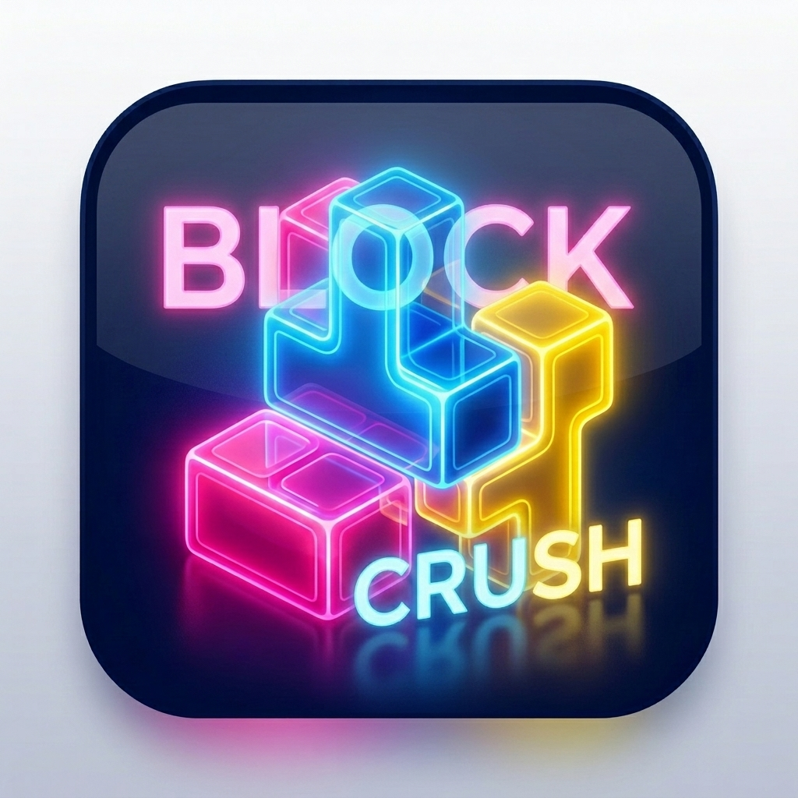

# 🎮 Block Crush — Premium Mobile Puzzle Game

<div align="center">
  
  
  <h3>A premium, ultra-performance block matching mobile game built with Flutter & Dart.</h3>

  [](https://flutter.dev/)
  [](https://dart.dev/)
  [](https://flutter.dev/)
  [](https://opensource.org/licenses/MIT)
</div>

---

## 📖 Overview

**Block Crush** is an elegant, high-fidelity block puzzle mobile application. Moving far beyond basic prototypes, this game features production-grade architectural patterns, advanced state management, immersive custom themes, responsive drag-and-drop mechanics, and specialized gameplay elements. 

Every pixel, haptic vibration, sound effect, and frame rate render has been optimized to produce an industry-standard product ready for the app store.

---

## 🎮 Play Live & Download

Experience **Block Crush** across different mediums:

<table>
  <tr>
    <td align="center"><strong>🌐 Web Version</strong></td>
    <td align="center"><strong>📲 Android Native</strong></td>
    <td align="center"><strong>🎥 Gameplay Preview</strong></td>
  </tr>
  <tr>
    <td align="center">
      Play directly in your browser:<br/><br/>
      <a href="https://md-rounaq-ali.github.io/block-crush-game/">
        
      </a>
    </td>
    <td align="center">
      Download the production APK:<br/><br/>
      <a href="https://github.com/md-rounaq-ali/block-crush-game/releases/latest">
        
      </a>
    </td>
    <td align="center">
      
    </td>
  </tr>
</table>

---

## ✨ Features

### 🎨 Immersive Design & Theme Engine
- **Neon Glow**: Modern cyberpunk aesthetic featuring glowing particles, neon typography, and deep sapphire background gradients.
- **Classic Wood**: A relaxing, tactile experience with natural woody textures, borders, and satisfying soft clicks.
- **Precious Jewel**: High-contrast, bright gemstone shapes resembling premium matching games.

### ❄️ Strategic Gameplay Modifiers
- **Ice Blocks**: Frosted cells requiring **two consecutive line clears** to shatter, introducing a strategic priority mechanism.
- **Bomb Blocks**: Trigger explosive **3x3 grid detonations** when cleared, clearing surrounding blockages.
- **Dynamic Combo System**: Multi-line clears activate scaled scoring multipliers, reinforced with visual combo streaks and custom sound cues.

### 📈 Modern Mobile Polish
- **Daily Rewards Engine**: First-launch calendar checker using `SharedPreferences` that rewards users once per 24 hours with a glowing gift popup.
- **Interactive Onboarding**: A step-by-step tutorial overlay guiding new players through basic placement and mechanics.
- **Social Share Engine**: Real-time screenshot capture utilizing `ScreenshotController` and native media sharing capabilities.

---

## 🛠️ Architecture & Tech Stack

### High-Level Folder Layout
This project is built using a **Clean Feature-First Architecture** which separates infrastructure (`core`) from application logic (`features`).

```text
lib/
├── main.dart                      # App entry point with Provider initializations
├── app.dart                       # Global Material App settings & routes
├── core/
│   ├── audio/                     # Audio Controller (APIs, Mute logic)
│   ├── constants/                 # Core Colors, Game Constants
│   ├── theme/                     # AppTheme configuration & ThemeManager
│   └── widgets/                   # High-performance background painters
└── features/
    ├── home/                      # Launch screens, Settings modal, Daily reward widgets
    └── game/
        ├── logic/                 # Board logic (Explosions, Collision checks)
        ├── models/                # Immutably structured models (BlockModel, CellModel)
        ├── screens/               # Main Gameplay screens (Classic & Time Attack)
        └── widgets/               # Game Board, Board Cell, Draggable Block widgets
```

### Core Technologies
- **State Management**: `Provider` (for separation of presentation layers from business logic).
- **Animation Framework**: `Flutter Animate` (high-performance declarative transitions).
- **Audio Synthesis**: `AudioPlayers` (multithreaded local asset playback).
- **Persistent Storage**: `SharedPreferences` (high-score preservation, tutorial flags, reward cycles).

---

## ⚡ Engineering & Performance Optimizations

### 🚀 60+ FPS Custom Painters
The moving particle system inside the `AnimatedBackground` is isolated within a `RepaintBoundary`. This prevents the entire UI tree (scores, headers, and draggables) from being repainted every time a particle shifts, saving significant CPU/GPU compute cycles.

### 📐 Perfect Drag-and-Drop Math
We mapped touch global coordinates to local grid offsets relative to the game board. This ensures blocks align cleanly under the player's finger regardless of screen scaling, device aspect ratio, or inner paddings.

### 🔇 Resource Lifecycle Management
Controllers, audio channels, and game loops automatically dispose of their resources upon screen exit, eliminating memory leaks.

---

## 🚀 Local Setup & Installation

### 1. Prerequisites
- [Flutter SDK (Latest Stable)](https://docs.flutter.dev/get-started/install)
- Android Studio / VS Code with Dart plugin
- USB Debugging enabled on your target device

### 2. Run Commands
```bash
# Clone the repository
git clone https://github.com/md-rounaq-ali/block-crush-game.git
cd block-crush-game

# Install the correct dependencies
flutter pub get

# Generate launcher icons and splash screens
flutter pub run flutter_launcher_icons
flutter pub run flutter_native_splash:create

# Launch the app
flutter run
```

---

## 📄 License

This project is licensed under the MIT License - see the [LICENSE](LICENSE) file for details.

---

## 👨‍💻 Developed By

**Md Rounaq Ali**
*   **LinkedIn**: [linkedin.com/in/md-rounaq-ali](https://www.linkedin.com/in/md-rounaq-ali)
*   **GitHub**: [github.com/md-rounaq-ali](https://github.com/md-rounaq-ali)

*If you find this repository helpful, please leave a ⭐ star!*
