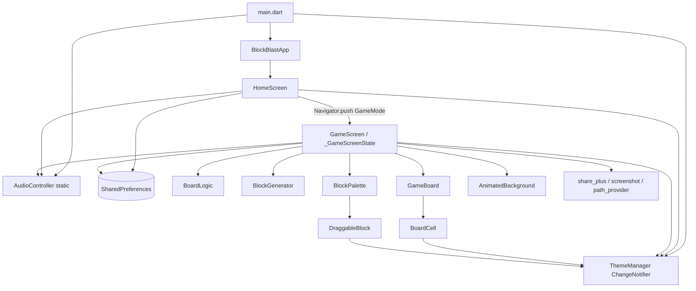
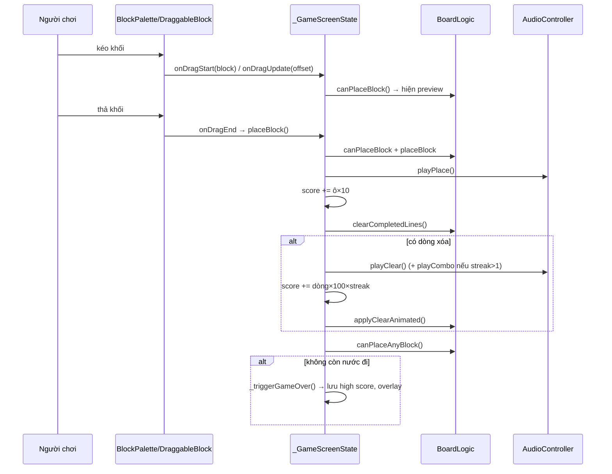
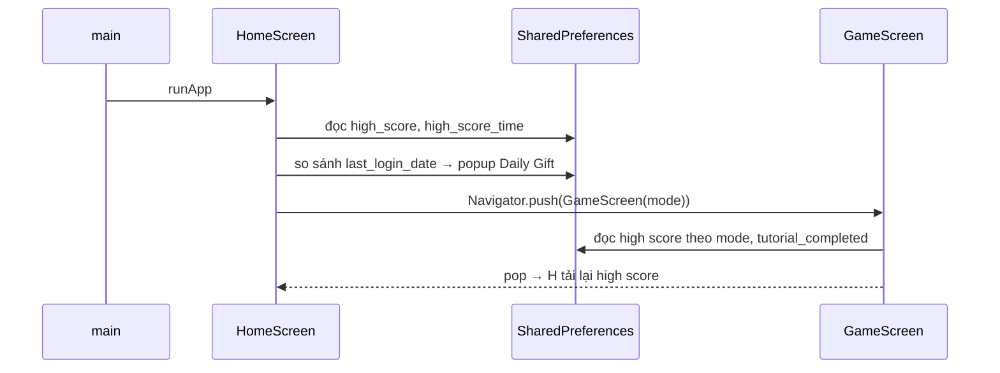

# Architecture — Block Crush

## Architecture Analysis

### System Overview

App Flutter một module, chạy hoàn toàn offline (không có backend, không có network). Có hai màn hình chính: `HomeScreen` và `GameScreen`. Theme được chia sẻ qua `provider`, âm thanh qua một static singleton, và dữ liệu nhỏ được lưu trong `SharedPreferences`.

### Architectural Style

**Monolithic client app, tổ chức theo feature** (`lib/core`, `lib/features/<feature>`, `lib/shared`). Bằng chứng:
- `main.dart` khởi tạo `MultiProvider` với một `ChangeNotifierProvider<ThemeManager>`.
- Logic game là các static helper (`BoardLogic`, `BlockGenerator`). State của ván chơi nằm trong `_GameScreenState`, theo pattern "fat StatefulWidget". Không có controller hay ViewModel: `game_controller.dart` là file rỗng.

### Component Relationships

Text fallback: `main` khởi tạo `AudioController` và `ThemeManager`, rồi chạy `BlockBlastApp` → `HomeScreen`. `HomeScreen` mở `GameScreen(mode)`. `GameScreen` dùng `BoardLogic` và `BlockGenerator` cho logic, `GameBoard`/`BoardCell` và `BlockPalette`/`DraggableBlock` cho UI, `AudioController` cho âm thanh, `SharedPreferences` cho high score và tutorial, và `share_plus` để chia sẻ.

### Interaction Diagrams

**Đặt khối và tính điểm**

**Khởi động và vào ván chơi**

Text fallback: đặt khối gồm kéo, preview, thả, đặt, tính điểm, xóa dòng, cộng combo, rồi kiểm tra game over. Khởi động gồm main, Home (đọc prefs, có thể hiện Daily Gift), rồi push GameScreen.

### Data Flow

- Dữ liệu chỉ có hai loại: state trong bộ nhớ (board `List<List<CellModel>>`, `blocks`, `score`, `comboStreak`, `_timeLeft`) và key trong `SharedPreferences` (`high_score`, `high_score_time`, `theme_index`, `last_login_date`, `tutorial_completed`).
- Màn hình con không trả dữ liệu về qua route. Home tải lại high score bằng callback `.then()` sau khi pop.

### Key Design Decisions

- Logic dạng static thuần, dễ test, nhưng state của ván dính chặt vào widget.
- `GameMode` là enum có nhánh rải rác. Bỏ Time Attack cần sửa khoảng 7 vị trí trong `game_screen.dart`.
- Theme toàn cục do người dùng chọn (Neon/Wood/Jewel), được widget đọc qua `context.watch<ThemeManager>()`.

### Improvement Opportunities

- Tách state của ván sang `GameController` (ChangeNotifier) trong file `game_controller.dart` đang rỗng. Việc này phục vụ trực tiếp NFR-01 (mở rộng controller) và giúp unit-test scoring cùng level target.
- Thêm lớp service (`RemoteConfigService`, `AnalyticsService`, `ProgressRepository`) để cô lập Firebase và SharedPreferences.
- Lưu trạng thái mute. Preload âm thanh.
