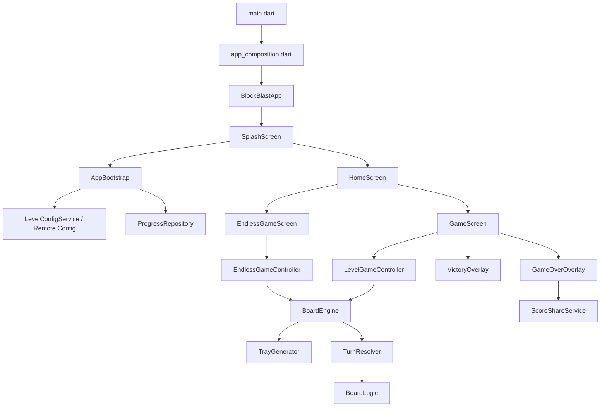
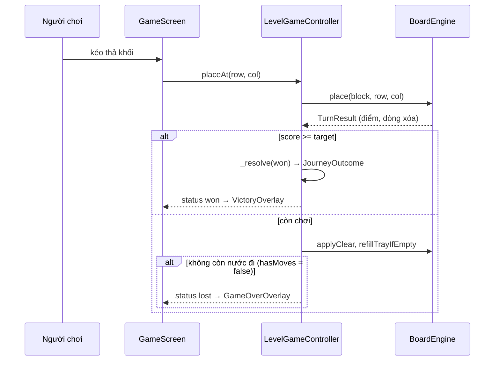
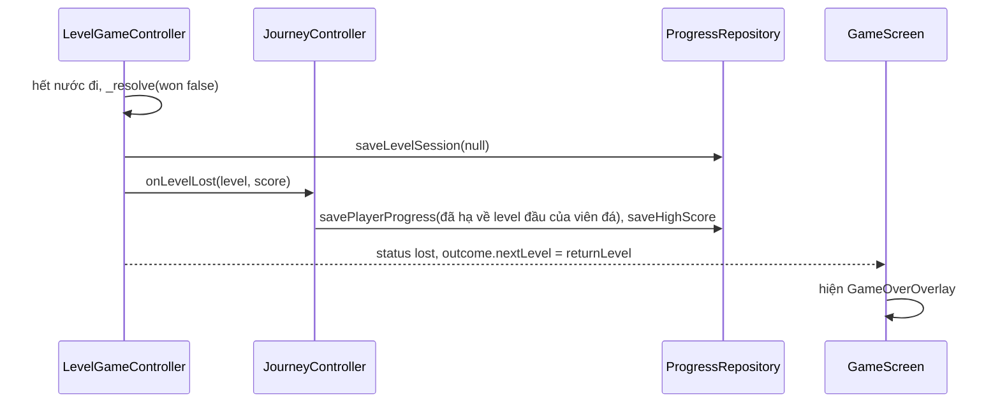

# Architecture

## Kiểu kiến trúc
Ứng dụng Flutter một module, feature-first, state bằng `provider` (ChangeNotifier). Logic thuần nằm trong `engine/` và `logic/`; screen chỉ render. Firebase và SharedPreferences nằm sau interface (`RemoteConfigClient`, `ProgressStore`, `AnalyticsService`).

## Sơ đồ thành phần

Văn bản: main → app_composition → BlockBlastApp → SplashScreen (AppBootstrap) → HomeScreen → GameScreen/EndlessGameScreen → controller → BoardEngine → TrayGenerator/TurnResolver/BoardLogic.

## Interaction Diagrams
### Một lượt đặt khối (Journey)

### Chia sẻ ảnh (hiện chỉ ở Game Over)
GameOverOverlay.onShare → ScoreShareService.shareScore(ScreenshotController, score) → capture → ghi score.png → Share.shareXFiles.

## Dòng dữ liệu
Remote Config → LevelConfigService → LevelCatalog (36 Level) → JourneyController. Tiến trình: JourneyController ↔ ProgressRepository ↔ SharedPreferences.

## Quyết định thiết kế đáng chú ý
- `BoardEngine` không biết level hay mốc điểm; nguồn khối là `BlockSource = List<BlockModel> Function()`.
- Điểm thắng được kiểm tra ngay sau khi tính điểm, trước animation xóa dòng.
- `pubspec.yaml` hiện không còn `flutter_native_splash`; chỉ còn `SplashScreen` trong code (xác nhận ở lần quét 261125).

## Cơ hội cải thiện
- Lần quét 261125 thấy `BlockGenerator` đã được thay bằng `TrayGenerator` cùng `TraySolver` và `DifficultyProfile` (`lib/features/game/logic/`); nhận định cũ rằng generator tĩnh không còn đúng.
- Tên game hiển thị xuất hiện ở nhiều nơi (`MaterialApp.title`, Android label, iOS `CFBundleDisplayName`, `ScoreShareService.gameName`), chưa có một hằng số trung tâm.

## Luồng thua ván (quan trọng cho reward ads)

Nghĩa là phiên chơi đã bị xóa và tiến trình đã bị hạ **trước khi** lớp phủ Game Over hiện. Reward ads kiểu "xóa sạch ô và chơi tiếp ở level đó" cần chặn hoặc hoàn tác hai bước lưu này (`level_game_controller.dart`, `journey_controller.dart`). `playAgain()` chỉ chạy khi `status == lost` và gọi `start(outcome.nextLevel ?? returnLevel)`.

## Điểm gắn cho intent 261125-ads-remote-config
- **Khởi tạo**: `AppBootstrap.run` (hạn chót 3,5 giây) dựng `AppServices`; dịch vụ quảng cáo và phiên bản nên cùng chỗ hoặc ngay sau.
- **Cấu hình**: `RemoteConfigClient` chỉ đọc khóa `level_config`, với `minimumFetchInterval` 12 giờ và `fetchTimeout` 2 giây (`firebase_remote_config_client.dart`).
- **Màn chơi**: `GameScreen` là `Stack` gồm nền, `Column` trong `SafeArea` (header, vùng combo cao 44, `Expanded` bảng và khay), và các lớp phủ.
- **Đếm Start**: `HomeScreen._startGame` (và `_startEndless`) tạo controller rồi `Navigator.push`.
- **Chia sẻ**: `ScoreShareService.scoreShareText` và `victoryShareText`.
