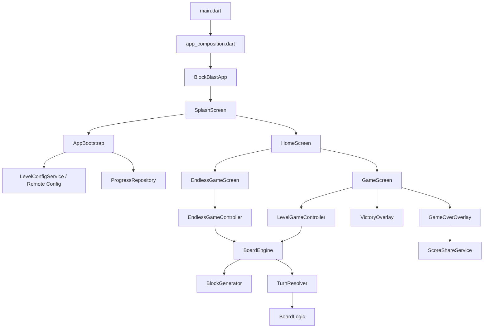
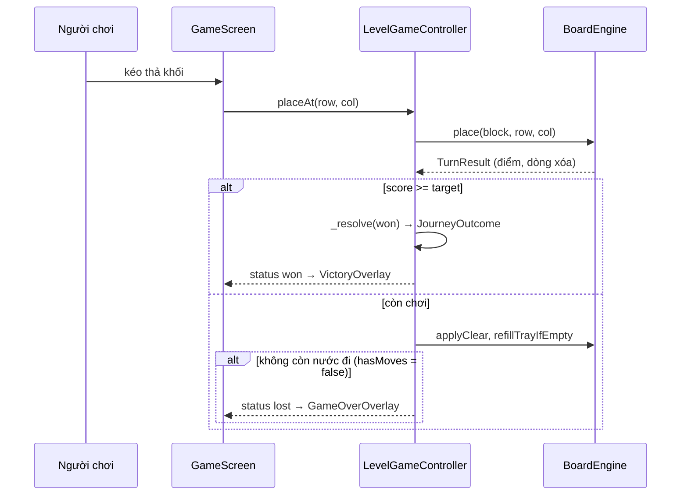

# Architecture

## Kiểu kiến trúc
Ứng dụng Flutter một module, feature-first, state bằng `provider` (ChangeNotifier). Logic thuần nằm trong `engine/` và `logic/`; screen chỉ render. Firebase và SharedPreferences nằm sau interface (`RemoteConfigClient`, `ProgressStore`, `AnalyticsService`).

## Sơ đồ thành phần

Văn bản: main → app_composition → BlockBlastApp → SplashScreen (AppBootstrap) → HomeScreen → GameScreen/EndlessGameScreen → controller → BoardEngine → BlockGenerator/TurnResolver/BoardLogic.

## Interaction Diagrams
### Một lượt đặt khối (Journey)

### Chia sẻ ảnh (hiện chỉ ở Game Over)
GameOverOverlay.onShare → ScoreShareService.shareScore(ScreenshotController, score) → capture → ghi score.png → Share.shareXFiles.

## Dòng dữ liệu
Remote Config → LevelConfigService → LevelCatalog (36 Level) → JourneyController. Tiến trình: JourneyController ↔ ProgressRepository ↔ SharedPreferences.

## Quyết định thiết kế đáng chú ý
- `BoardEngine` không biết level hay mốc điểm; nguồn khối là `BlockSource = List<BlockModel> Function()`.
- Điểm thắng được kiểm tra ngay sau khi tính điểm, trước animation xóa dòng.
- Hai splash: native (`flutter_native_splash`) rồi `SplashScreen` trong code.

## Cơ hội cải thiện
- `BlockGenerator` tĩnh, không nhận board/level, khó test và khó điều chỉnh độ khó.
- Chuỗi tên game rải nhiều nơi, chưa có một hằng số trung tâm.
