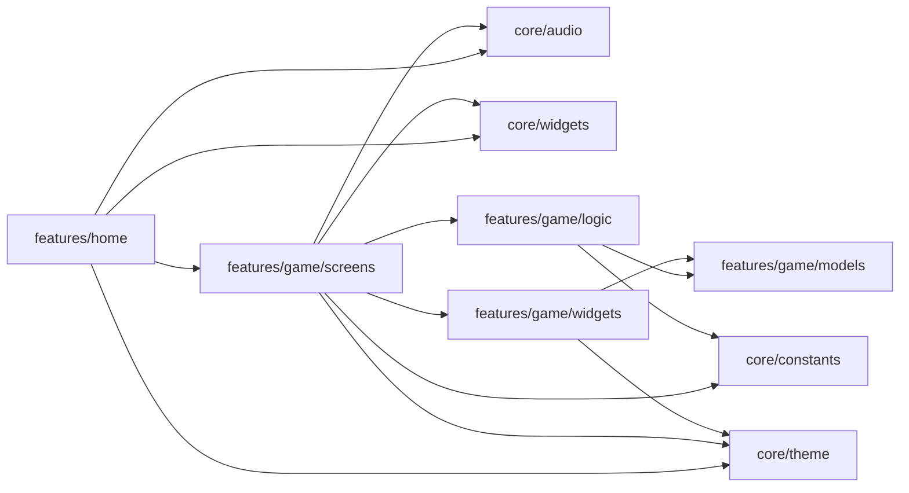

# Dependencies — Block Crush

## External (pub)

Danh sách phiên bản xem ở `technology-stack.md`. Dưới đây là thành phần dùng từng package:

| Package | Dùng bởi |
|---------|----------|
| provider | `main.dart`, `HomeScreen`, `GameScreen`, `GameBoard`, `BoardCell`, `DraggableBlock` |
| shared_preferences | `ThemeManager`, `HomeScreen`, `GameScreen` |
| flutter_animate | `HomeScreen`, `GameScreen` |
| audioplayers | `AudioController` |
| google_fonts | `AppTheme` |
| share_plus, screenshot, path_provider | `GameScreen` (chỉ phục vụ share score) |

**Dependency cần thêm cho intent** (theo requirements NFR-04): `firebase_core`, `firebase_remote_config`, `firebase_analytics`. Có thể thêm `firebase_storage` hoặc `cached_network_image` nếu tải ảnh nền từ Firebase Storage.

## Internal (module → module)

Text fallback: `home` phụ thuộc `game/screens` và `core/*`. `game/screens` phụ thuộc `game/logic`, `game/widgets` và `core/*`. `logic` và `widgets` phụ thuộc `models`. Không có phụ thuộc vòng.

Lưu ý: `enum GameMode` được khai báo trong `game_screen.dart` và `HomeScreen` import nó từ đó, tức là màn hình phụ thuộc vào kiểu dữ liệu của một màn hình khác.

## Phụ thuộc nền tảng

- Android: `MainActivity.kt` ở package `com.example.block_blast`. Chưa có Google Services plugin hay `google-services.json`.
- iOS: chưa có `GoogleService-Info.plist`.
