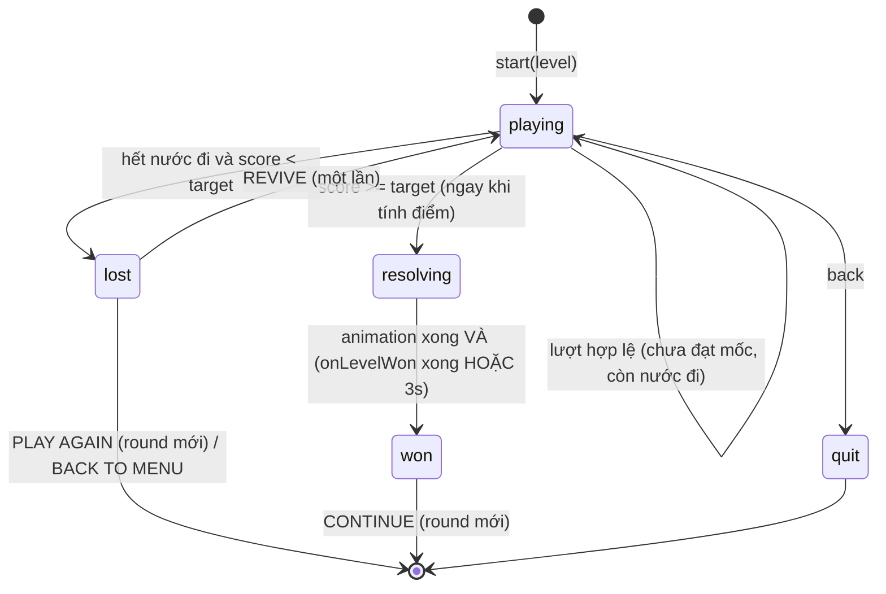
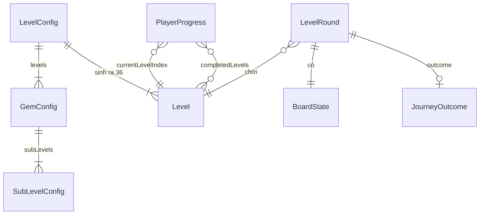

# Functional Specification — U1 `u1-journey-skeleton`

## Sources

- `entities.md`, `rules.md` (nguồn sự thật cho dữ liệu và quy tắc)
- [units] `inception/units-generation/unit-of-work.md` (U1, thứ tự 4 bước, kiểm chứng end-to-end)
- [contract] `inception/contract-design/contract-summary.md`
- [mock] `inception/refined-mockups/mockups.md` (M-0, M-1, M-2; Victory tạm theo Q3)
- [Q1]–[Q4] `functional-design-questions.md`
- [review] `reviews/review-01.md`: bản này đã sửa theo R-01..R-10

## Phạm vi

Walking skeleton: mở app → cấu hình (remote, cached hoặc default) → Home → PLAY → chơi Classic ở level hiện tại với mốc điểm → đạt mốc thì Victory tạm → CONTINUE → level kế tiếp → tiến trình được lưu và khôi phục khi mở lại.

**Không thuộc U1:**
- Quy tắc thua reset về Rough Stone, QuitDialog, Game Over mới, high score theo level (U2)
- Hiệu ứng Victory và âm thanh mới (U3)
- Màu đá quý, ảnh nền, font (U4)
- Analytics và thời lượng phiên (U5)
- Endless (U6)

## Workflow WF1 — Khởi động app (bootstrap), hạn chót 3,5 giây (BR1.8)

1. `main` khởi tạo binding và audio (như hiện tại). Ghi mốc t0, hạn chót = t0 + 3,5s.
2. `Firebase.initializeApp`, tối đa **1,5s** (BR1.5). Lỗi hoặc quá thời gian thì "Firebase không khả dụng" trong phiên này, log, sang bước 4 với `source=default`.
3. Nếu Firebase khả dụng: `LevelConfigService.initialize()`.
   - fetchAndActivate được chờ tối đa min(2s, hạn chót − 0,5s − bây giờ) (BR1.1).
   - Kết quả (remote, hoặc bản đã activate trước đó nếu fetch hết thời gian) được validate theo BR1.2 và BR1.3. Hỏng thì dùng mặc định (BR1.4).
   - Mốc không tăng dần chỉ log (BR1.6).
4. Dựng `LevelCatalog` 36 level, bất biến trong phiên (BR2.1, BR2.3, BR2.4).
5. `ProgressRepository.load()`, tối đa 0,5s: đọc `progress` và `tutorial_completed`. Hỏng hoặc quá thời gian thì dùng mặc định cho key đó (BR3.1, BR3.5).
6. Log `config_source` (BR1.7). Chuyển Splash sang Home.
7. Nếu hạn chót đến khi một bước chưa xong thì bỏ bước đó (dùng cached hoặc default) và vào Home ngay. **Splash không bao giờ treo quá 3,5s.**

## Workflow WF2 — Home → bắt đầu ván

1. Home hiển thị nhãn `"<gemName> · <subName>"` của `currentLevelIndex`, nút **PLAY** (≥ 48dp) và nút Settings (giữ nguyên).
   - Không còn thẻ chế độ (BR6.3).
   - Daily Gift giữ đến U4.
2. Bấm PLAY: `LevelGameController.start(currentLevel)`.
   - Tạo `roundId` mới, `targetScore = max(1, level.targetScore)` (BR5.5).
   - `score=0`, `comboStreak=0`, `revived=false`, `clearing=false`, `status=playing`, sinh 3 khối.
   - Nếu `tutorialCompleted=false` thì hiện tutorial (BR3.4).

## Workflow WF3 — Một lượt đặt khối

1. `status ≠ playing` hoặc `clearing = true` thì bỏ qua (BR5.4, BR5.10).
2. Kéo khối: hiện preview nếu đặt được (giữ hành vi hiện tại).
3. Thả khối ở vị trí hợp lệ:
   - Đặt khối. Tính điểm ngay: ô × 10, xác định dòng đầy, combo (BR5.1, BR5.2).
   - Cập nhật `progressPercent` (BR5.6).
   - Tutorial đang hiện thì đánh dấu đã xong (BR3.4).
4. **Kiểm tra thắng trước animation:** nếu `score ≥ target` thì `status = resolving` ngay (khóa input, kể cả back) và sang WF4 (BR5.3).
5. Nếu có dòng đầy: `clearing = true`, chạy animation xóa 180ms, rồi `clearing = false` (BR5.10). Back trong lúc này vẫn hợp lệ nếu `status = playing` (BR5.8).
6. Khay trống thì sinh 3 khối mới.
7. Chỉ khi **không** thắng: nếu không còn nước đi thì sang WF5 (BR5.7).

## Workflow WF4 — Thắng (walking skeleton)

1. Đang ở `resolving` (input và back bị bỏ qua).
2. **Song song:** (a) animation xóa dòng nếu có, (b) `JourneyController.onLevelWon(level, score)`.
   - Cập nhật cache theo BR4.1/BR4.2, rồi await ghi (BR3.2).
   - Ghi lỗi thì dirty (BR3.3) và vẫn trả outcome (BR4.3).
3. Chờ cả (a) và (b). Nếu (b) chưa xong sau **3 giây** thì dùng outcome tính từ cache và log (BR5.9).
4. `status = won`, `outcome` có giá trị. Hiện **Victory tạm** (overlay): "Level Complete!", `"<score> / <target>"`, nút CONTINUE (Q3).
5. Bấm CONTINUE: bắt đầu ván mới ở `outcome.nextLevel` (WF2 bước 2). Nếu `nextLevel = null` (level 36) thì bắt đầu lại level 36 (BR4.2).

## Workflow WF5 — Hết nước đi (U1)

1. `status = lost`. Hiện overlay Game Over hiện có: FINAL SCORE, SHARE SCORE, PLAY AGAIN, REVIVE (chỉ khi `revived = false`), BACK TO MENU (BR5.7).
2. `PlayerProgress` **không đổi**, và không gọi `onLevelLost`.
3. Các lựa chọn:
   - REVIVE: xóa vùng 3×3 giữa bảng, `revived = true`, `status = playing`.
   - PLAY AGAIN: `LevelRound` mới (`roundId` mới, `revived=false`, score 0) cùng level.
   - BACK TO MENU hoặc back hệ thống: về Home.
4. Input chơi bị bỏ qua khi `lost` (BR5.4).

## Workflow WF6 — Thoát giữa ván (U1)

Bấm ← hoặc nút back của hệ thống khi `status = playing` (kể cả trong animation xóa dòng) thì `status = quit` và về Home, tiến trình không đổi (BR5.8). Khi `resolving`, back bị bỏ qua (BR5.4). Dialog xác nhận sẽ có ở U2.

## Workflow WF7 — App vào nền

`AppLifecycleState.paused` gọi `ProgressRepository.flushDirty()`, xếp vào cuối hàng đợi ghi (BR3.2, BR3.3). Ở U1 không có xử lý nào khác.

**Điểm mở rộng cho U5:** `SessionTracker` sẽ đăng ký cùng sự kiện `paused` để gửi `game_session` và gọi `addPlayTime` (AC1.6.2 hoãn sang U5). U1 không để lại hook đặc biệt nào: U5 tự thêm observer vòng đời của riêng mình.

## State machine — LevelRound.status

Text fallback:
- `playing` → `resolving` ngay khi đạt mốc. `resolving` → `won` khi animation xóa dòng xong và việc lưu xong, hoặc sau 3 giây. `won` → CONTINUE mở round mới.
- `playing` → `lost` khi hết nước đi (U1 không đổi tiến trình). `lost` → REVIVE quay lại `playing` (một lần), hoặc PLAY AGAIN mở round mới, hoặc BACK TO MENU về Home.
- `playing` → `quit` khi bấm back.
- Mọi `switch` trên `status` liệt kê đủ 5 giá trị (contract C2).

## ER view (derived from `entities.md`)

Text fallback:
- `LevelConfig` chứa 6 `GemConfig`, mỗi `GemConfig` chứa 6 `SubLevelConfig`. `LevelConfig` sinh ra 36 `Level`.
- `PlayerProgress` tham chiếu `Level` qua `currentLevelIndex` và `completedLevels`.
- `LevelRound` chơi một `Level`, có một `BoardState`, và có thể có một `JourneyOutcome`.

## Rules summary (derived from `rules.md`)

| Workflow | Rules |
|----------|-------|
| WF1 | BR1.1–BR1.8, BR2.1–BR2.4, BR3.1, BR3.5 |
| WF2 | BR5.5, BR3.4, BR6.3 |
| WF3 | BR5.1–BR5.4, BR5.6, BR5.10, BR3.4 |
| WF4 | BR4.1–BR4.3, BR3.2, BR3.3, BR2.2, BR5.3, BR5.9 |
| WF5 | BR5.7, BR5.4 |
| WF6 | BR5.8, BR5.4 |
| WF7 | BR3.2, BR3.3 |
| Toàn unit | BR6.1, BR6.2, BR6.4, BR7.1, BR7.2 |

## UI tối thiểu của U1

| Màn | Thay đổi |
|-----|----------|
| Splash | Giữ native splash. Thêm `SplashScreen` Flutter chờ bootstrap tối đa 3,5s (logo và chỉ báo) |
| Home | Bỏ hai thẻ chế độ. Thêm nhãn level và nút PLAY (≥ 48dp). Giữ Settings và Daily Gift (U4 gỡ). Màu dùng `AppColors` hiện có |
| Game header | `[←]`, tên level, `"score / target"`, thanh tiến độ có nhãn `%` (BR5.6). Bỏ TIME/BEST cũ |
| Victory tạm | Overlay: "Level Complete!", `"score / target"`, CONTINUE |
| Game Over | Giữ overlay hiện có. Hiển thị khi `status = lost` (BR5.7) |

## Thứ tự triển khai (theo `unit-of-work.md`)

1. BR6.1, BR6.2 và Firebase init (kèm timeout BR1.5), sửa `test/widget_test.dart`. Người dùng build thử.
2. (Sao lưu lần 2) Tách `BoardEngine`/`TurnResolver` (BR5.1, BR5.2), gỡ Time Attack (BR6.3).
3. `LevelConfigService`, `LevelCatalog`, `AppBootstrap` (BR1.x, BR2.x).
4. `ProgressRepository`, `JourneyController`, `LevelGameController` và UI (BR3.x, BR4.x, BR5.3–BR5.10), rồi kiểm chứng end-to-end.

## Assumptions & Open Questions

None.
