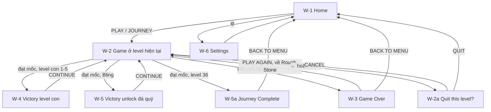

# User Flow — Gemstone Journey

## Sources

- [scope] `ideation/scope-definition/scope-document.md`
- [wire] `wireframes.md` (W-1 đến W-6)
- [Q1]–[Q10] `rough-mockups-questions.md`
- [gate] Phản hồi Request Changes của người dùng ở cổng phê duyệt

## Luồng chính (happy path)

1. Mở app, vào **W-1 Home**. App hiển thị level hiện tại theo tiến trình đã lưu. [Q1] [Q9]
2. Bấm **PLAY / JOURNEY**, vào thẳng **W-2 Game** ở level hiện tại. [Q1] [Q9]
3. Chơi Classic cho đến khi đạt mốc điểm. [scope]
4. Nếu là level con 1–5, sang **W-4 Victory**. Bấm CONTINUE để sang W-2 ở level con kế tiếp. [scope]
5. Nếu là level Bling, sang **W-5 Victory (unlock)**. Bấm CONTINUE để sang W-2 ở Rough Stone của đá quý kế tiếp. [scope]
6. Nếu là Ruby · Bling (level 36), sang **W-5a Journey Complete**. Không có CONTINUE, chỉ có BACK TO MENU để về W-1. [gate]

## Luồng thoát giữa ván

- Bấm [←] hoặc Back của hệ thống, mở **W-2a** "Quit this level?". CANCEL thì chơi tiếp, QUIT thì về W-1. [gate]

## Luồng thua

- Hết chỗ đặt block, hiện **W-3 Game Over** kèm thông báo sẽ quay về Rough Stone của level lớn hiện tại. [Q5] [scope]
- Bấm PLAY AGAIN để sang W-2 ở Rough Stone. Bấm BACK TO MENU để về W-1. [Q5] [gate] [wire]



Text fallback: Home → (PLAY) Game. Game → (đạt mốc) Victory → (CONTINUE) Game ở level kế tiếp. Level 36 → Journey Complete → Home. Game → (← / Back) Quit dialog → CANCEL (chơi tiếp) hoặc QUIT (về Home). Game → (thua) Game Over → PLAY AGAIN (về Rough Stone) hoặc về Home. Home ↔ Settings.

## Information Architecture

```
Home (W-1)
├── Settings (W-6)
└── Game (W-2)
    ├── Victory: level con (W-4)
    ├── Exit confirmation (W-2a)
    ├── Victory: level lớn (W-5)
    ├── Journey Complete (W-5a)
    └── Game Over (W-3)
```

## Assumptions & Open Questions

- [assumption] Sau khi hoàn thành level 36, bấm PLAY trên Home sẽ chơi lại Ruby · Bling. Cần xác nhận ở bước Requirements Analysis.
- Ngôn ngữ giao diện: chỉ tiếng Anh. [gate]
