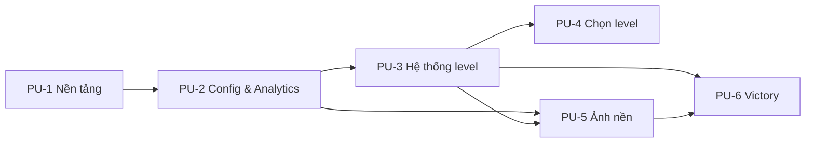

# Intent Backlog — Gemstone Journey

## Sources

- [scope] `scope-document.md` (S-01 đến S-12)
- [req] File requirements (DocumentKB `01a1cee8-…`), đưa vào scope qua [Q1]
- [Q6] Thứ tự ưu tiên: dependency-first

## Proto-Units (MoSCoW, sắp theo phụ thuộc)

| Thứ tự | Proto-Unit | Hạng mục scope | MoSCoW | Phụ thuộc | Nguồn |
|--------|-----------|----------------|--------|-----------|-------|
| 1 | **PU-1 Nền tảng**: đổi package Android/iOS, setup Firebase core | S-09 | Must | — | [Q4] [Q6] |
| 2 | **PU-2 Cấu hình & Analytics**: Remote Config kèm fallback, Analytics service, sync khi có mạng | S-03, S-04, S-10 | Must | PU-1 | [Q2] [Q5] [Q6] |
| 3 | **PU-3 Hệ thống level**: level model, điểm theo level, quy tắc khi thua, Classic mode only, lưu tiến trình | S-01, S-02, S-08 | Must | PU-2 (mốc điểm) | [req] [Q6] |
| 4 | **PU-4 Chọn level**: màn hình level lớn và level con | S-07 | Must | PU-3 | [req] [Q6] |
| 5 | **PU-5 Ảnh nền**: Firebase Storage kèm fallback, blur khi chơi, cache | S-05, S-12 | Must | PU-2, PU-3 | [Q2] [Q6] |
| 6 | **PU-6 Victory**: confetti, glow, âm thanh, unlock đá quý 2D | S-06, S-11 | Must | PU-3, PU-5 | [Q3] [Q7] [Q6] |
| — | Đá quý 3D xoay | — | Won't (đợt này) | PU-6 | [Q3] |
| — | Quảng cáo / IAP | — | Won't (đợt này) | — | [Q1] |

## Value Stream (text)

Khởi động app → fetch Remote Config / dùng fallback (PU-2) → chọn level lớn → chọn level con (PU-4) → chơi Classic với ảnh nền bị blur (PU-3, PU-5) → đạt mốc điểm thì vào Victory (PU-6) rồi sang level tiếp theo; thua thì về Rough Stone → lưu tiến trình và gửi event Analytics (PU-3, PU-2). [scope] [req]

Text fallback: PU-1 → PU-2 → PU-3 → (PU-4, PU-5). PU-6 phụ thuộc PU-3 và PU-5.

## Assumptions & Open Questions

- [assumption] Ranh giới giữa các proto-unit có thể còn được điều chỉnh ở bước Units Generation.
