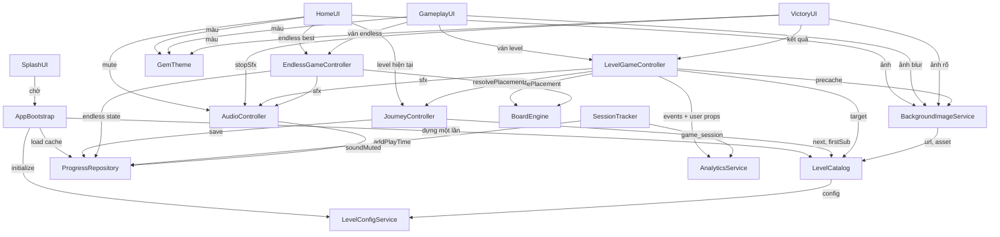

# Components — Gemstone Journey

## Sources

- [req] `inception/requirements-analysis/requirements.md` (FR1–FR14, NFR1–NFR11)
- [stories] `inception/user-stories/stories.md` (US1.1–US8.6)
- [codekb] `aidlc/spaces/default/codekb/block-crush-game-main/architecture.md`, `component-inventory.md`
- [prac] `inception/practices-discovery/team-practices.md`: tách logic sang controller/service
- [Q1]–[Q5] `domain-design-questions.md`
- [review] `reviews/review-01.md` (R-01..R-09): bản này đã sửa theo các góp ý đó

## Part A — Catalogue

```yaml
components:
  - name: LevelConfigService
    summary: Fetch, validate và fallback cấu hình level từ Firebase Remote Config
    behaviour: >
      initialize() gọi fetchAndActivate với minimumFetchInterval 12h, timeout 2 giây.
      Parse JSON theo schema của requirements (version, levels.<gem>.sub_levels.<sub>.target_score, background_url tùy chọn).
      Validate toàn cấu hình: đủ đúng 36 cặp gem/sub hợp lệ, không trùng, không thiếu; target_score là số nguyên trong khoảng 1..10,000,000.
      Vi phạm bất kỳ điều nào thì loại bỏ toàn bộ JSON và dùng config mặc định nhúng trong app.
      target_score không tăng dần chỉ log cảnh báo, không loại bỏ.
      Config đã activate hoặc cache bị hỏng cũng coi như mất và dùng mặc định. Không thử khôi phục.
      Validate từng URL ảnh: chỉ nhận https với host firebasestorage.googleapis.com hoặc *.firebasestorage.app.
      URL sai, rỗng hoặc host lạ thì chỉ đặt backgroundUrl = null cho level đó (giữ asset), không loại cả config.
      Mọi lỗi được log (debugPrint), không ném ra ngoài và không hiện cho người chơi.
      Truy cập Firebase qua interface RemoteConfigClient để test bằng fake.
    responsibilities:
      - Nguồn duy nhất của cấu hình level đã được validate
      - Config mặc định nhúng trong app (giống JSON trong file requirements)
    depends_on: []
    dependents:
      - component: LevelCatalog
        interaction: lấy LevelConfig đã validate để dựng danh sách 36 level
      - component: AppBootstrap
        interaction: gọi initialize() một lần khi mở app
    external_dependencies:
      - name: Firebase Remote Config
        kind: third-party-api
        purpose: mốc điểm và URL ảnh nền có thể chỉnh từ xa
    entities:
      - name: LevelConfig
        identifier: version
        attributes: [version, levels, source]

  - name: LevelCatalog
    summary: Danh sách có thứ tự, BẤT BIẾN trong phiên, của 36 level và phép điều hướng giữa các level
    behaviour: >
      Được dựng MỘT LẦN bởi AppBootstrap từ LevelConfig đang hiệu lực sau splash.
      Không thay đổi trong suốt phiên. Config mới (nếu activate muộn) chỉ có hiệu lực ở lần mở app sau.
      Đánh số levelIndex 1..36 theo thứ tự gem (Rose Quartz..Ruby) rồi sub (Rough Stone..Bling).
      Cung cấp next(level) (level 36 trả về journeyComplete), firstSubOf(gem), isBling, isFinal.
      Ánh xạ ảnh asset: assets/design/Level<gemOrder>/<subOrder>.jpg. Logic thuần, không có I/O.
    responsibilities:
      - Định danh và thứ tự level
      - Mốc điểm và URL ảnh của từng level, cố định trong phiên
    depends_on:
      - component: LevelConfigService
        interaction: đọc LevelConfig đã validate khi được dựng
        style: sync
    dependents:
      - component: AppBootstrap
        interaction: dựng catalog một lần
      - component: JourneyController
        interaction: tính level kế tiếp, Rough Stone của đá quý hiện tại
      - component: LevelGameController
        interaction: lấy target của level đang chơi
      - component: BackgroundImageService
        interaction: lấy URL và đường dẫn asset của ảnh nền
    external_dependencies: []
    entities:
      - name: Level
        identifier: levelIndex
        attributes: [levelIndex, gemId, gemName, gemOrder, subId, subName, subOrder, targetScore, backgroundUrl, assetPath]
        references:
          - entity: LevelConfig
            owned_by: LevelConfigService
            relationship: mỗi Level lấy targetScore và backgroundUrl từ LevelConfig đang hiệu lực

  - name: AppBootstrap
    summary: Khởi tạo các service và dựng LevelCatalog trước khi vào Home
    behaviour: >
      Gọi LevelConfigService.initialize() (tối đa 2 giây), dựng LevelCatalog, tải ProgressRepository cache.
      Trả về Future hoàn tất để SplashUI điều hướng sang Home.
      Lỗi bất kỳ bước nào thì dùng mặc định và vẫn hoàn tất, không bao giờ treo splash.
    responsibilities:
      - Thứ tự khởi tạo của app
    depends_on:
      - component: LevelConfigService
        interaction: initialize()
        style: async
      - component: LevelCatalog
        interaction: dựng catalog bất biến
        style: sync
      - component: ProgressRepository
        interaction: load() nạp cache trong bộ nhớ
        style: async
    dependents:
      - component: SplashUI
        interaction: chờ bootstrap hoàn tất
    external_dependencies: []
    entities: []

  - name: ProgressRepository
    summary: Bộ ghi DUY NHẤT dữ liệu bền vững của người chơi trên SharedPreferences
    behaviour: >
      Chỉ đọc/ghi, không có quy tắc nghiệp vụ.
      Giữ cache trong bộ nhớ, nạp một lần qua load(). Mọi thao tác ghi đi qua một hàng đợi tuần tự (Future chain), nên không có ghi chồng.
      Mỗi phần dữ liệu ghi vào key RIÊNG để không ghi đè lẫn nhau:
      progress (currentLevelIndex, completedLevels, unlockedGems, journeyCompleted, highestLevelReached), high_scores, total_play_time, endless_saved_score, endless_high_score, sound_muted, tutorial_completed.
      API cập nhật từng phần (savePlayerProgress, saveHighScore, addPlayTime, saveEndlessState, setSoundMuted), mỗi hàm trả về Future hoàn tất khi đã ghi đĩa.
      Dữ liệu thiếu hoặc hỏng (parse lỗi, levelIndex ngoài 1..36) thì trả về mặc định và log lỗi, không crash.
      Gỡ các key cũ high_score, high_score_time, theme_index, last_login_date.
      Test bằng SharedPreferences.setMockInitialValues.
    responsibilities:
      - Persist PlayerProgress, EndlessState, PlayerSettings
      - Tuần tự hóa mọi lần ghi
    depends_on: []
    dependents:
      - component: AppBootstrap
        interaction: load() khi mở app
      - component: JourneyController
        interaction: savePlayerProgress, saveHighScore
      - component: EndlessGameController
        interaction: saveEndlessState
      - component: AudioController
        interaction: setSoundMuted
      - component: SessionTracker
        interaction: addPlayTime
    external_dependencies:
      - name: SharedPreferences
        kind: database
        purpose: lưu trữ cục bộ key-value
    entities:
      - name: PlayerProgress
        identifier: progressKey
        attributes: [currentLevelIndex, completedLevels, unlockedGems, highScores, totalPlayTime, journeyCompleted, highestLevelReached]
        references:
          - entity: Level
            owned_by: LevelCatalog
            relationship: currentLevelIndex, completedLevels và highScores tham chiếu Level theo levelIndex
      - name: EndlessState
        identifier: endlessKey
        attributes: [endlessSavedScore, endlessHighScore]
      - name: PlayerSettings
        identifier: settingsKey
        attributes: [soundMuted, tutorialCompleted]

  - name: JourneyController
    summary: Quy tắc hành trình thuần — level hiện tại, thắng, thua, mở khóa, hoàn thành
    behaviour: >
      Future<JourneyOutcome> onLevelWon(level, score): thêm level vào completedLevels, cập nhật highScore nếu cao hơn,
      tăng highestLevelReached (không bao giờ giảm). Nếu là Bling thì mở khóa gem. Nếu là level 36 thì đặt journeyCompleted.
      Ngược lại đặt currentLevel = next(level). Future chỉ hoàn tất SAU KHI repository đã ghi xong.
      Future<JourneyOutcome> onLevelLost(level, score): xóa mọi sub của gem hiện tại khỏi completedLevels (kể cả đã thắng),
      đặt currentLevel = Rough Stone của gem đó, cập nhật highScore nếu cao hơn, lưu xong rồi mới hoàn tất.
      Gem đã mở khóa trước đó không bị ảnh hưởng.
      JourneyOutcome chứa nextLevel, unlockedGem, journeyCompleted, highestLevelReached để caller tự gửi analytics.
      Không phụ thuộc analytics. Chỉ phụ thuộc catalog và repository.
    responsibilities:
      - Trạng thái hành trình hiện tại cho Home và Game
      - Áp dụng quy tắc FR2 lên PlayerProgress
    depends_on:
      - component: LevelCatalog
        interaction: next(), firstSubOf(), isBling, isFinal
        style: sync
      - component: ProgressRepository
        interaction: đọc cache, lưu PlayerProgress và high score
        style: async
    dependents:
      - component: LevelGameController
        interaction: báo thắng hoặc thua của ván level
      - component: HomeUI
        interaction: đọc level hiện tại và journeyCompleted
    external_dependencies: []
    entities: []

  - name: BoardEngine
    summary: Luật bảng 8×8 và xử lý một lượt đặt khối, dùng chung cho cả hai chế độ
    behaviour: >
      Gồm BoardLogic và BlockGenerator hiện có (giữ nguyên), thêm TurnResolver.
      resolvePlacement(board, block, row, col, comboStreak) trả về TurnResult:
      cellsPlaced×10 + linesCleared×100×comboStreak, comboStreak mới (reset về 0 khi không xóa dòng), hasAnyMove.
      TurnResolver là nơi DUY NHẤT tính điểm. Giữ nguyên ice, bomb và combo hiện có.
      BlockGenerator nhận Random có thể inject để test tất định. Logic thuần, không có I/O.
    responsibilities:
      - Trạng thái bảng và khay khối trong một ván
      - Tính điểm, combo, phát hiện hết nước đi
    depends_on: []
    dependents:
      - component: LevelGameController
        interaction: xử lý lượt đặt khối ở chế độ level
      - component: EndlessGameController
        interaction: xử lý lượt đặt khối ở chế độ endless
    external_dependencies: []
    entities:
      - name: BoardState
        identifier: roundId
        attributes: [cells, trayBlocks, score, comboStreak]

  - name: LevelGameController
    summary: Một ván ở chế độ level — thắng khi đạt mốc, thua khi hết nước đi
    behaviour: >
      ChangeNotifier. start(): chốt targetScore của level tại thời điểm bắt đầu (không đổi trong ván), score 0, gửi level_start, precache ảnh level kế tiếp.
      Trạng thái: playing → resolving → won | lost, hoặc quit.
      Sau mỗi lượt: nếu score >= target thì THẮNG được ưu tiên hơn hết nước đi trong cùng lượt.
      Chuyển sang resolving (khóa input, bỏ qua mọi lượt hoặc sự kiện thắng/thua tiếp theo),
      await JourneyController.onLevelWon, sau đó mới đặt status = won và notify (UI mở Victory).
      Tiếp theo gửi level_complete, set user properties từ JourneyOutcome, phát victory/unlock.
      Nếu score < target và không còn nước đi: resolving → await onLevelLost → lost → level_fail, gameover sfx.
      QUIT ở playing thì bỏ ván, không tính thua. Không có Time Attack, không có Revive.
      Tiến độ % = floor(score/target×100), tối đa 99 khi chưa đạt.
    responsibilities:
      - Vòng đời ván level và chống xử lý thắng/thua hai lần
      - Toàn bộ analytics của ván level (event và user property)
    depends_on:
      - component: BoardEngine
        interaction: resolvePlacement mỗi lượt
        style: sync
      - component: JourneyController
        interaction: await onLevelWon / onLevelLost
        style: async
      - component: LevelCatalog
        interaction: target và thông tin của level hiện tại
        style: sync
      - component: AnalyticsService
        interaction: level_start, level_complete, level_fail, user properties
        style: async
      - component: AudioController
        interaction: âm thanh place/clear/combo/gameover/victory/unlock
        style: async
      - component: BackgroundImageService
        interaction: precache ảnh level kế tiếp
        style: async
    dependents:
      - component: GameplayUI
        interaction: GameScreen và GameOverOverlay render state, gửi thao tác kéo-thả
      - component: VictoryUI
        interaction: đọc kết quả (score, target, best, outcome) để hiển thị
    external_dependencies: []
    entities:
      - name: LevelRound
        identifier: roundId
        attributes: [levelIndex, targetScore, status, progressPercent, outcome]
        references:
          - entity: Level
            owned_by: LevelCatalog
            relationship: mỗi LevelRound chơi một Level
          - entity: BoardState
            owned_by: BoardEngine
            relationship: mỗi LevelRound có một BoardState

  - name: EndlessGameController
    summary: Một ván ở chế độ endless sau Journey Complete — lưu điểm khi tạm dừng, thua thì về 0
    behaviour: >
      ChangeNotifier. Bắt đầu với score = endlessSavedScore trên bảng TRỐNG.
      Chỉ lưu điểm, không lưu BoardState và comboStreak. Đây là hành vi có chủ ý theo FR9.3.
      Khi QUIT, về Home hoặc app vào background (AppLifecycleState.paused) thì saveEndlessState(score).
      Hết nước đi thì cập nhật endlessHighScore nếu cao hơn, đặt endlessSavedScore = 0.
      App bị kill đột ngột mà không qua paused thì có thể mất điểm của lần chơi cuối. Đây là hạn chế đã chấp nhận.
      Cung cấp bestScore cho Home. Không có target, không có Victory, không gửi event level.
    responsibilities:
      - Vòng đời ván endless và EndlessState
    depends_on:
      - component: BoardEngine
        interaction: resolvePlacement mỗi lượt
        style: sync
      - component: ProgressRepository
        interaction: đọc và saveEndlessState
        style: async
      - component: AudioController
        interaction: âm thanh gameplay
        style: async
    dependents:
      - component: GameplayUI
        interaction: GameScreen (endless) và GameOverOverlay (endless)
      - component: HomeUI
        interaction: hiển thị "Endless · Best N"
    external_dependencies: []
    entities: []

  - name: AnalyticsService
    summary: Lớp bọc Firebase Analytics — tên event và tham số cố định
    behaviour: >
      Interface (abstract class) với triển khai Firebase và triển khai fake cho test.
      level_start{major, sub, level_index}, level_complete/level_fail{major, sub, level_index, score, target}, game_session{duration_sec}.
      User property current_major_level, highest_level_reached.
      Lỗi SDK được log, không ném ra ngoài. SDK tự xếp hàng khi offline.
      Triển khai Firebase được giữ mỏng (chỉ chuyển tiếp lời gọi).
    responsibilities:
      - Định nghĩa schema event duy nhất
    depends_on: []
    dependents:
      - component: LevelGameController
        interaction: event level và user properties
      - component: SessionTracker
        interaction: game_session
    external_dependencies:
      - name: Firebase Analytics
        kind: third-party-api
        purpose: đo session time, retention, tỉ lệ hoàn thành level
    entities: []

  - name: SessionTracker
    summary: Theo dõi vòng đời app để đo thời lượng phiên
    behaviour: >
      WidgetsBindingObserver, dùng interface Clock có thể inject để test.
      Bắt đầu đếm khi resumed. Khi paused thì gửi game_session{duration_sec} và addPlayTime(duration) qua hàng đợi ghi của repository.
      detached không được hệ điều hành đảm bảo, nên chỉ coi là best-effort. paused là điểm ghi chính.
    responsibilities:
      - Thời lượng phiên chơi
    depends_on:
      - component: AnalyticsService
        interaction: game_session
        style: async
      - component: ProgressRepository
        interaction: addPlayTime
        style: async
    dependents: []
    external_dependencies: []
    entities: []

  - name: BackgroundImageService
    summary: Chọn và cache ảnh nền của level (URL đã validate ưu tiên, asset dự phòng)
    behaviour: >
      Trả về ImageProvider asset ngay lập tức. Nếu Level.backgroundUrl khác null (đã được LevelConfigService validate là https và host cho phép)
      thì tải qua ImageLoader (triển khai mặc định dùng cached_network_image và disk cache) để UI cross-fade 300ms khi sẵn sàng.
      Lỗi tải thì giữ asset và log. precache(level) cho level kế tiếp.
      Không dùng firebase_storage SDK.
    responsibilities:
      - Nguồn ảnh nền và cache
    depends_on:
      - component: LevelCatalog
        interaction: backgroundUrl và assetPath
        style: sync
    dependents:
      - component: LevelGameController
        interaction: precache level kế tiếp
      - component: HomeUI
        interaction: ảnh nền của level hiện tại
      - component: GameplayUI
        interaction: LevelBackground blur
      - component: VictoryUI
        interaction: ảnh rõ nét
    external_dependencies:
      - name: cached_network_image / flutter_cache_manager
        kind: cache
        purpose: tải và cache ảnh trên đĩa
      - name: Firebase Storage (public download URL)
        kind: object-store
        purpose: lưu ảnh nền, truy cập qua HTTPS, bucket chỉ cho đọc
    entities: []

  - name: GemTheme
    summary: Bảng màu theo đá quý thay cho ThemeManager
    behaviour: >
      Bảng tĩnh gemPrimary, gemSecondary, onGemPrimary cho 6 đá quý (FR12.1), kèm màu nút Amethyst #7A4FB0 để đạt tương phản.
      Khối trên bảng giữ màu ngẫu nhiên. Gỡ ThemeManager, AppThemeType và theme_index.
    responsibilities:
      - Token màu theo đá quý
    depends_on: []
    dependents:
      - component: HomeUI
        interaction: màu nền và nút
      - component: GameplayUI
        interaction: màu nền, thanh tiến độ
      - component: VictoryUI
        interaction: glow, confetti, nút
    external_dependencies: []
    entities: []

  - name: AudioController
    summary: Phát âm thanh hiệu ứng, tôn trọng mute đã lưu
    behaviour: >
      Giữ API hiện có, thêm playVictory, playUnlock, stopSfx.
      Mute được đọc từ cache của repository và lưu qua setSoundMuted. Khi muted thì không gọi play.
      Lỗi phát được log, không nuốt im lặng. Player có thể inject để test.
    responsibilities:
      - Phát và dừng 6 âm thanh
    depends_on:
      - component: ProgressRepository
        interaction: đọc và setSoundMuted
        style: async
    dependents:
      - component: LevelGameController
        interaction: âm thanh gameplay và victory/unlock
      - component: EndlessGameController
        interaction: âm thanh gameplay
      - component: HomeUI
        interaction: Settings bật/tắt âm thanh
      - component: VictoryUI
        interaction: stopSfx khi bấm CONTINUE
    external_dependencies:
      - name: audioplayers
        kind: other
        purpose: phát file wav/mp3
    entities: []

  - name: SplashUI
    summary: Màn splash chờ bootstrap tối đa 2 giây
    behaviour: >
      Hiển thị logo, gọi AppBootstrap.run(), xong thì điều hướng sang Home. Chỉ render.
    responsibilities:
      - Màn khởi động
    depends_on:
      - component: AppBootstrap
        interaction: chờ hoàn tất
        style: async
    dependents: []
    external_dependencies: []
    entities: []

  - name: HomeUI
    summary: Home (một nút PLAY, nhãn level, Journey Complete) và Settings sheet
    behaviour: >
      Đọc level hiện tại và journeyCompleted từ JourneyController, BEST endless từ EndlessGameController (hiển thị "—" khi chưa có).
      Settings chỉ có âm thanh. Không có Daily Gift. Chỉ render.
    responsibilities:
      - Màn chính và cài đặt
    depends_on:
      - component: JourneyController
        interaction: level hiện tại, journeyCompleted
        style: sync
      - component: EndlessGameController
        interaction: bestScore
        style: sync
      - component: BackgroundImageService
        interaction: ảnh nền
        style: async
      - component: GemTheme
        interaction: màu
        style: sync
      - component: AudioController
        interaction: bật/tắt mute
        style: sync
    dependents: []
    external_dependencies: []
    entities: []

  - name: GameplayUI
    summary: GameScreen, LevelHeader, LevelProgressBar, LevelBackground, QuitDialog, GameOverOverlay
    behaviour: >
      Render state của LevelGameController hoặc EndlessGameController. Chuyển thao tác kéo-thả xuống controller.
      PopScope chặn Back để mở QuitDialog. GameOverOverlay không có Revive, có SHARE SCORE. Chỉ render.
    responsibilities:
      - Màn chơi và overlay
    depends_on:
      - component: LevelGameController
        interaction: state và thao tác của ván level
        style: sync
      - component: EndlessGameController
        interaction: state và thao tác của ván endless
        style: sync
      - component: BackgroundImageService
        interaction: ảnh nền blur
        style: async
      - component: GemTheme
        interaction: màu
        style: sync
    dependents: []
    external_dependencies:
      - name: share_plus / screenshot / path_provider
        kind: other
        purpose: SHARE SCORE
    entities: []

  - name: VictoryUI
    summary: VictoryScreen (sub, gemUnlock, journeyComplete), confetti, animation unlock đá quý 2D
    behaviour: >
      Chỉ mở sau khi LevelGameController ở trạng thái won (tiến trình đã lưu).
      CONTINUE hiện ngay. Bấm thì khóa nút, gọi stopSfx, dừng animation rồi điều hướng.
      journeyComplete không có CONTINUE, chỉ có BACK TO MENU. Chỉ render.
    responsibilities:
      - Màn ăn mừng
    depends_on:
      - component: LevelGameController
        interaction: kết quả ván
        style: sync
      - component: BackgroundImageService
        interaction: ảnh rõ nét
        style: async
      - component: GemTheme
        interaction: màu
        style: sync
      - component: AudioController
        interaction: stopSfx
        style: sync
    dependents: []
    external_dependencies: []
    entities: []
```

## Part B — Human view

### Component Diagram



Text fallback:
- **UI:** SplashUI gọi AppBootstrap. HomeUI gọi JourneyController, EndlessGameController, BackgroundImageService, GemTheme và AudioController. GameplayUI gọi LevelGameController, EndlessGameController, BackgroundImageService và GemTheme. VictoryUI gọi LevelGameController, BackgroundImageService, GemTheme và AudioController.
- **Khởi tạo:** AppBootstrap gọi LevelConfigService, LevelCatalog và ProgressRepository.
- **Controller:** LevelGameController gọi BoardEngine, JourneyController, LevelCatalog, AnalyticsService, AudioController và BackgroundImageService. EndlessGameController gọi BoardEngine, ProgressRepository và AudioController. JourneyController gọi LevelCatalog và ProgressRepository.
- **Còn lại:** LevelCatalog gọi LevelConfigService. SessionTracker gọi AnalyticsService và ProgressRepository. BackgroundImageService gọi LevelCatalog. AudioController gọi ProgressRepository.

### Component Summary

| Component | Purpose | Depends On | Dependents | Entities Owned |
|-----------|---------|-----------|-----------|----------------|
| LevelConfigService | Remote Config, validate (cả URL), fallback | — | LevelCatalog, AppBootstrap | LevelConfig |
| LevelCatalog | 36 level, bất biến trong phiên | LevelConfigService | AppBootstrap, JourneyController, LevelGameController, BackgroundImageService | Level |
| AppBootstrap | Thứ tự khởi tạo | LevelConfigService, LevelCatalog, ProgressRepository | SplashUI | — |
| ProgressRepository | Bộ ghi duy nhất, tuần tự, theo từng key | — | AppBootstrap, JourneyController, EndlessGameController, AudioController, SessionTracker | PlayerProgress, EndlessState, PlayerSettings |
| JourneyController | Quy tắc hành trình thuần | LevelCatalog, ProgressRepository | LevelGameController, HomeUI | — |
| BoardEngine | Luật bảng, nơi duy nhất tính điểm | — | LevelGameController, EndlessGameController | BoardState |
| LevelGameController | Ván level và analytics của nó | BoardEngine, JourneyController, LevelCatalog, AnalyticsService, AudioController, BackgroundImageService | GameplayUI, VictoryUI | LevelRound |
| EndlessGameController | Ván endless | BoardEngine, ProgressRepository, AudioController | GameplayUI, HomeUI | — |
| AnalyticsService | Bọc Firebase Analytics | — | LevelGameController, SessionTracker | — |
| SessionTracker | Thời lượng phiên | AnalyticsService, ProgressRepository | — | — |
| BackgroundImageService | Ảnh nền và cache | LevelCatalog | LevelGameController, HomeUI, GameplayUI, VictoryUI | — |
| GemTheme | Màu theo đá quý | — | HomeUI, GameplayUI, VictoryUI | — |
| AudioController | Âm thanh và mute | ProgressRepository | LevelGameController, EndlessGameController, HomeUI, VictoryUI | — |
| SplashUI | Màn splash | AppBootstrap | — | — |
| HomeUI | Home và Settings | JourneyController, EndlessGameController, BackgroundImageService, GemTheme, AudioController | — | — |
| GameplayUI | Màn chơi và overlay | LevelGameController, EndlessGameController, BackgroundImageService, GemTheme | — | — |
| VictoryUI | Màn ăn mừng | LevelGameController, BackgroundImageService, GemTheme, AudioController | — | — |

### Entity Ownership

| Entity | Owning Component | Identifier | Attributes | References |
|--------|------------------|-----------|-----------|-----------|
| LevelConfig | LevelConfigService | version | version, levels, source | — |
| Level | LevelCatalog | levelIndex | levelIndex, gemId, gemName, gemOrder, subId, subName, subOrder, targetScore, backgroundUrl, assetPath | LevelConfig |
| PlayerProgress | ProgressRepository | progressKey | currentLevelIndex, completedLevels, unlockedGems, highScores, totalPlayTime, journeyCompleted, highestLevelReached | Level |
| EndlessState | ProgressRepository | endlessKey | endlessSavedScore, endlessHighScore | — |
| PlayerSettings | ProgressRepository | settingsKey | soundMuted, tutorialCompleted | — |
| BoardState | BoardEngine | roundId | cells, trayBlocks, score, comboStreak | — |
| LevelRound | LevelGameController | roundId | levelIndex, targetScore, status, progressPercent, outcome | Level, BoardState |

### External Dependencies

| Component | Dependency | Kind | Purpose |
|-----------|-----------|------|---------|
| LevelConfigService | Firebase Remote Config | third-party-api | Mốc điểm và URL ảnh |
| ProgressRepository | SharedPreferences | database | Lưu cục bộ |
| AnalyticsService | Firebase Analytics | third-party-api | Event và user property |
| BackgroundImageService | cached_network_image | cache | Cache ảnh |
| BackgroundImageService | Firebase Storage (public URL) | object-store | Ảnh nền, bucket chỉ cho đọc |
| AudioController | audioplayers | other | Phát âm thanh |
| GameplayUI | share_plus / screenshot / path_provider | other | Share score |

### Rationale

| Component | Vì sao tách riêng |
|-----------|-------------------|
| LevelConfigService | Ranh giới với hệ thống bên ngoài và dữ liệu không tin cậy (JSON, URL). Fallback và validate cần test riêng |
| LevelCatalog | Logic thuần, bất biến trong phiên, nền cho test 36 chuyển trạng thái |
| AppBootstrap | Gom thứ tự khởi tạo để UI không phụ thuộc trực tiếp vào service (R-03) |
| ProgressRepository | Cô lập I/O và là bộ ghi duy nhất để tránh ghi đè (Q3=A, R-02) |
| JourneyController | Quy tắc FR2, logic thuần không phụ thuộc analytics (Q3=A, R-04) |
| BoardEngine | Luật bảng dùng chung, nơi duy nhất tính điểm (Q2=B) |
| LevelGameController / EndlessGameController | Vòng đời và quy tắc khác nhau (Q2=B). Tách khỏi `_GameScreenState` (Q1=A) |
| AnalyticsService | Ranh giới với hệ thống bên ngoài, có fake để test schema |
| SessionTracker | Theo vòng đời app, độc lập với ván chơi |
| BackgroundImageService | Hai nguồn ảnh và cache |
| GemTheme | Thay ThemeManager, dữ liệu tĩnh |
| AudioController | Có sẵn, mở rộng mute được lưu |
| SplashUI / HomeUI / GameplayUI / VictoryUI | Practices: screen chỉ render. Tách theo feature (R-08) |

**Alternatives Rejected:**
- `GameSessionController` dùng chung kèm mode policy: bị loại theo lựa chọn Q2=B (ADR-002).
- Gộp `ProgressService`: bị loại theo lựa chọn Q3=A (ADR-003).
- Event bus: bị loại theo lựa chọn Q4=A (ADR-004).
- Một component `GameUI` gộp mọi màn hình: tách thành 4 component theo góp ý R-08.

### Cấu trúc thư mục (Q5=A)

```
lib/core/firebase/       remote_config_service.dart (LevelConfigService + RemoteConfigClient), analytics_service.dart, firebase_config.dart
lib/core/services/       progress_repository.dart, background_image_service.dart, session_tracker.dart, app_bootstrap.dart, clock.dart
lib/core/theme/          gem_theme.dart (thay theme_manager.dart)
lib/core/audio/          audio_controller.dart (mở rộng)
lib/features/game/models/       level_model.dart (Level, LevelCatalog), progress_model.dart, board_state.dart
lib/features/game/logic/        board_logic.dart, block_generator.dart, turn_resolver.dart (BoardEngine)
lib/features/game/controllers/  journey_controller.dart, level_game_controller.dart, endless_game_controller.dart
lib/features/game/screens|widgets/  GameScreen, LevelHeader, LevelProgressBar, QuitDialog, GameOverOverlay, LevelBackground
lib/features/victory/           screens/victory_screen.dart, widgets/confetti_widget.dart, gemstone_unlock_animation.dart
lib/features/home/, lib/features/splash/  HomeScreen, SettingsSheet, SplashScreen
```

## Assumptions & Open Questions

- [assumption] `PlayerSettings.tutorialCompleted` giữ key cũ `tutorial_completed` để không hiện lại tutorial cho người chơi cũ.
- [assumption] Giới hạn trên của target_score (10,000,000) do kiến trúc sư đề xuất. Mặc định lớn nhất trong requirements là 350,000.
- [assumption] Danh sách host ảnh cho phép chỉ gồm `firebasestorage.googleapis.com` và `*.firebasestorage.app`.
