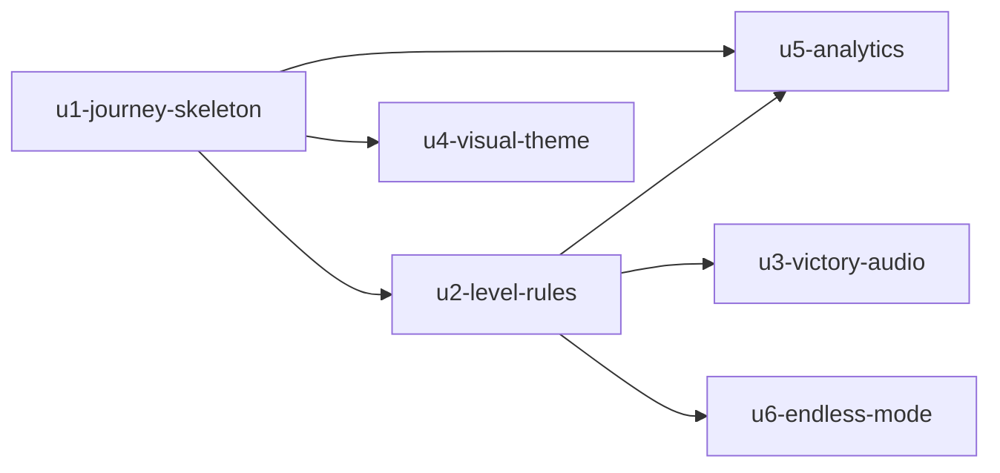

# Unit Dependencies — Gemstone Journey

## Sources

- `unit-of-work.md` (U1..U6)
- [comp] `inception/domain-design/components.md`
- [Q3] `units-generation-questions.md`: cho phép làm song song
- [review] `reviews/review-01.md`: R-02 (quy ước màu), R-03 (cạnh U5 → U2)

## DAG

```yaml
units:
  - name: u1-journey-skeleton
    kind: service
    depends_on: []
  - name: u2-level-rules
    kind: service
    depends_on: [u1-journey-skeleton]
  - name: u3-victory-audio
    kind: ui
    depends_on: [u2-level-rules]
  - name: u4-visual-theme
    kind: ui
    depends_on: [u1-journey-skeleton]
  - name: u5-analytics
    kind: service
    depends_on: [u1-journey-skeleton, u2-level-rules]
  - name: u6-endless-mode
    kind: service
    depends_on: [u2-level-rules]
```



Text fallback: U2 và U4 phụ thuộc U1. U5 phụ thuộc U1 và U2. U3 và U6 phụ thuộc U2. Không có chu trình.

## Lý do các cạnh

| Cạnh | Lý do |
|------|-------|
| U2 → U1 | U2 mở rộng `JourneyController`, `ProgressRepository` và `LevelGameController` mà U1 tạo ra |
| U3 → U2 | Các biến thể Victory gemUnlock và journeyComplete cần `JourneyOutcome.unlockedGemId` và `journeyCompleted` từ U2 |
| U4 → U1 | Cần `LevelCatalog` (assetPath, backgroundUrl) và Home/Game từ U1 |
| U5 → U1 | Gắn event vào vòng đời `LevelGameController` từ U1 |
| U5 → U2 | `level_fail` cần nhánh thua (`onLevelLost`) và user property cần `JourneyOutcome` đầy đủ, cả hai đều có ở U2 [review R-03] |
| U6 → U2 | Chỉ có hiệu lực khi `journeyCompleted` được đặt (U2) |

## Integration points

| Giữa | Điểm tích hợp | Kiểu |
|------|---------------|------|
| U1 ↔ U2 | `JourneyController.onLevelWon → Future<JourneyOutcome{nextLevel, highestLevelReached}>` (U1). U2 thêm `onLevelLost` và các trường `unlockedGemId`, `journeyCompleted`. API từng phần của `ProgressRepository` | API nội bộ (Dart) |
| U2 ↔ U3 | `LevelGameController` ở trạng thái `won` kèm `outcome` → `VictoryUI(variant)` | API nội bộ |
| U1 ↔ U4 | `Level.assetPath` và `Level.backgroundUrl` (định nghĩa ở U1, dùng ở U4). U1 giữ `ThemeManager`. U4 là chủ sở hữu duy nhất của `GemTheme` và thay toàn bộ tham chiếu `ThemeManager` | API nội bộ |
| U3 ↔ U4 | U3 dùng hằng số tạm `VictoryColors.accent` (một file duy nhất). U4 thay bằng `GemTheme` rồi xóa file đó | API nội bộ |
| U1/U2 ↔ U5 | `AnalyticsService` inject vào `LevelGameController`. U1 và U2 dùng no-op cho đến khi U5 có triển khai Firebase | API nội bộ |
| U2 ↔ U6 | `EndlessState` trong `ProgressRepository`. `HomeUI` đọc `journeyCompleted` | Dữ liệu dùng chung (prefs) |

## Walking skeleton

**U1 là unit đầu tiên của DAG và là lát cắt tích hợp.** U1 không phụ thuộc unit nào, nên tự chạy được đầy đủ luồng mở app → Remote Config/fallback → Home → PLAY → thắng → level kế tiếp → lưu và khôi phục. Các phần U2–U6 thêm vào sau không thay đổi đường tích hợp này. Một số phần trong U1 được giữ tạm, các unit sau mở rộng chúng: `AnalyticsService` dùng no-op, Victory chỉ là màn tạm, Game Over dùng bản cũ, màu vẫn lấy từ `ThemeManager`. Thứ tự giảm rủi ro bên trong U1 và checklist sao lưu nằm trong `unit-of-work.md`.

## Cơ hội làm song song

- Sau U1: {U2, U4} không phụ thuộc nhau.
- Sau U2: {U3, U5, U6} không phụ thuộc nhau, và có thể xen kẽ với U4 nếu U4 chưa xong.

Có nhiều thứ tự topo hợp lệ. Thứ tự cụ thể chốt ở Delivery Planning. [Q3]

Lưu ý thực tế: không dùng git nên mọi unit ghi trực tiếp vào cùng một workspace. "Song song" ở đây nghĩa là thứ tự linh hoạt, không phải chạy đồng thời trên nhiều nhánh. [prac]
