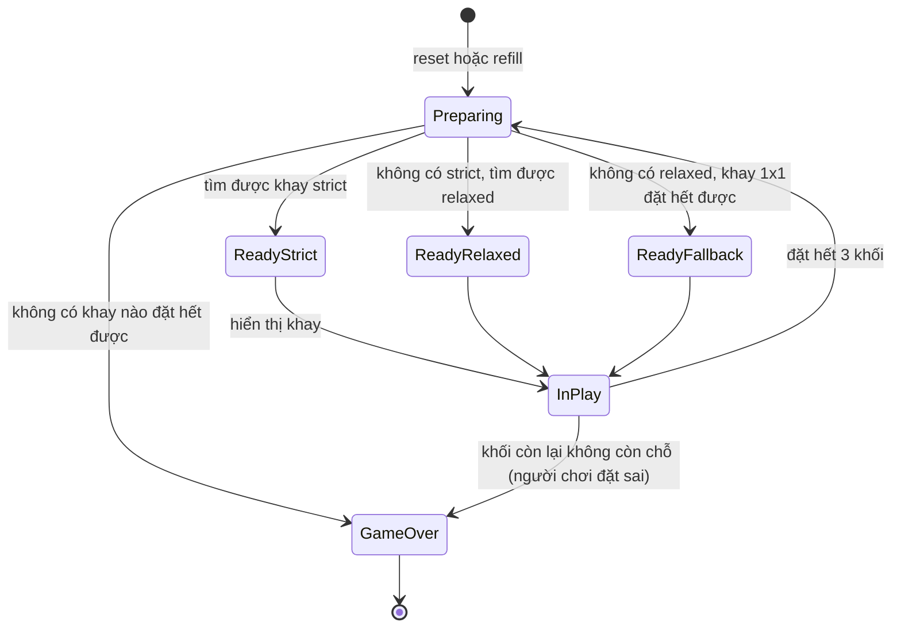
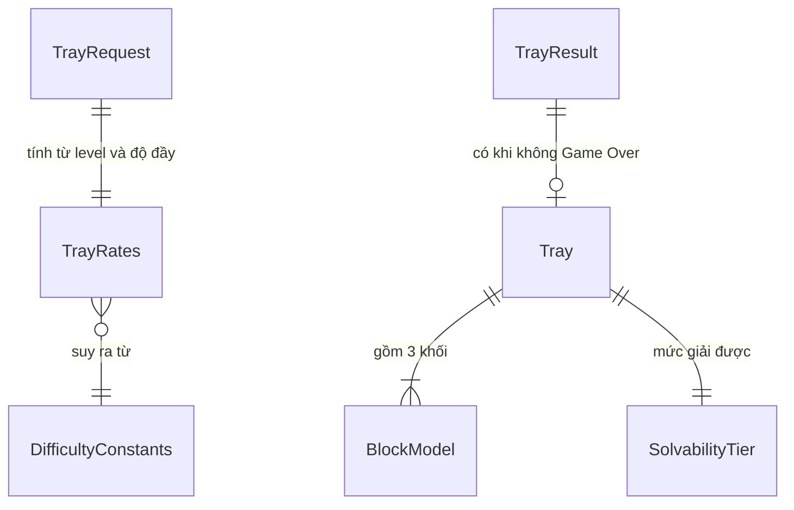

# Functional Spec: u3-tray-algorithm

Nguồn: unit-of-work.md (U3), requirements.md (FR4, NFR1–NFR3), stories US4.1–US4.6, components.md, và các câu trả lời trong `functional-design-questions.md`. Nguồn sự thật cho dữ liệu là `entities.md`, cho luật là `rules.md`; tệp này là nguồn sự thật cho luồng và trạng thái.

## Thay đổi so với yêu cầu đã duyệt

Theo quyết định của người dùng ở Câu 1 (message f0e6f665) và Câu 3–5, thiết kế này thay cơ chế "thay một khối khi không khối nào vừa" (FR4.1, FR4.2, AC4.1.1, AC4.1.2 và đoạn mô tả TrayGenerator trong components.md) bằng cơ chế tính trước:

- Khay đã hiển thị thì không đổi (BR1.1).
- Trước khi hiển thị, thuật toán chọn khay mà đặt đúng thì không thua (BR1.2, BR1.3).
- Nếu không còn khay nào đặt hết được thì Game Over ngay khi chuẩn bị khay (BR1.4).

Người chơi vẫn có thể thua khi đặt sai: khay strict bảo đảm mọi thứ tự đều có cách đặt hết, nhưng một chuỗi vị trí cụ thể do người chơi chọn có thể làm khối sau không còn chỗ. Các tệp `requirements.md` và `components.md` chưa được sửa; các giai đoạn sau theo tệp này. Nên cập nhật hai tệp đó khi có dịp.

## Luồng: chuẩn bị khay

Được gọi khi bắt đầu ván (reset) và mỗi khi người chơi đặt hết 3 khối của khay (refill).

1. `BoardEngine` gọi `TrayGenerator.prepare(board, level, random)`. Level của Endless là 18; level của Journey là `levelIndex`.
2. `DifficultyProfile` tính `TrayRates` từ `level` và độ đầy của bảng (BR2.3, BR3.1, BR3.2).
3. Mức strict: lặp tối đa `maxStrictCandidates` lần.
   1. Sinh 3 khối ứng viên (xem "Sinh một khối").
   2. Gọi bộ giải kiểm tra mọi thứ tự đều đặt hết được (BR1.2). Đạt thì trả khay với tier = strict và dừng.
4. Mức relaxed: lặp tối đa `maxRelaxedCandidates` lần như bước 3, nhưng chỉ cần một thứ tự đặt hết được (BR1.3). Đạt thì trả khay với tier = relaxed.
5. Mức fallback: kiểm tra khay {1x1, 1x1, 1x1} bằng bộ giải (BR1.4, BR1.5). Đặt hết được thì trả khay với tier = fallback.
6. Còn lại: trả `gameOver = true`, không có khay. `LevelGameController` hoặc `EndlessGameController` chuyển sang Game Over.

Nếu ngân sách `solverNodeBudget` cạn trong lúc kiểm tra một ứng viên, ứng viên đó coi là chưa chứng minh được và bị loại ở mức hiện tại (BR5.4); Game Over chỉ phát sinh từ bước 6.

## Luồng: sinh một khối

1. Lấy `rescueRate` từ `TrayRates`. Nếu bảng có hình xóa được dòng và `random < rescueRate` thì chọn ngẫu nhiên một hình xóa được, đánh `isClearing` (BR2.1). Nếu không có hình nào xóa được thì tiếp tục bước 2 (BR2.2).
2. Chọn nhóm kích thước nhỏ/vừa/lớn theo `smallRate`, `mediumRate`, `largeRate`. Nếu khay đã có 2 khối lớn thì chọn lại chỉ trong nhỏ/vừa (BR3.3).
3. Chọn ngẫu nhiên một hình trong nhóm đó từ `BlockCatalog`.
4. Gán màu, băng 5%, bom 5% theo cơ chế hiện có (BR5.3).

## Luồng: bộ giải (solver)

Đầu vào: bảng 8×8, một khay 3 khối, chế độ (strict hoặc relaxed), ngân sách nút.

1. Mô phỏng trên bản sao bảng, dùng `BoardLogic` để kiểm tra đặt vừa và xóa dòng, nên tính cả việc dòng bị xóa giữa chừng làm trống thêm ô.
2. Với một thứ tự cho trước, tìm kiếm theo chiều sâu: đặt khối thứ nhất ở một vị trí hợp lệ, xóa dòng, rồi đặt khối thứ hai, rồi khối thứ ba. Thoát ngay khi một chuỗi vị trí đặt hết 3 khối.
3. Strict: cả 6 thứ tự đều phải có chuỗi đặt hết được. Relaxed: chỉ cần một thứ tự.
4. Mỗi nút duyệt trừ vào ngân sách chung. Cạn ngân sách thì trả "chưa chứng minh" (không phải "không giải được"). Thứ tự duyệt vị trí cố định để kết quả tất định theo seed (BR5.2).

Khay {1x1, 1x1, 1x1} không cần tìm kiếm khi bảng còn ít nhất 3 ô trống: luôn đặt hết được (BR1.5).

## Trạng thái khay (state machine)

Văn bản: Preparing chọn một trong ba mức khay hoặc GameOver. Khay sẵn sàng chuyển sang InPlay và không bị đổi. Đặt hết 3 khối thì quay lại Preparing; nếu khối còn lại không còn chỗ trong lúc chơi thì thua (khác hành vi cũ ở chỗ không có bước thay khối).

## Mối quan hệ thực thể (dẫn xuất từ entities.md)

## Tóm tắt luật (dẫn xuất từ rules.md)

| Nhóm | Luật |
|---|---|
| Khay bảo đảm | BR1.1 bất biến, BR1.2 strict, BR1.3 relaxed, BR1.4 fallback hoặc Game Over, BR1.5 từ 3 ô trống không thua ở bước chuẩn bị |
| Khối cứu | BR2.1, BR2.2, BR2.3 (30% → 10%) |
| Tỉ lệ kích thước | BR3.1, BR3.2 (bảng trên 60%), BR3.3 (tối đa 2 khối lớn) |
| Độ khó | BR4.1 tăng theo level, BR4.2 Endless level 18 |
| Chất lượng | BR5.1 hằng số một nơi, BR5.2 tất định theo seed, BR5.3 giữ băng/bom/màu, BR5.4 dưới 16 ms |

## Xử lý lỗi và trường hợp biên

- Level ngoài 1..36 được kẹp vào khoảng đó trước khi tính `t`.
- Bảng đầy hoàn toàn: bước 5 không đặt được khay 1x1 nên trả Game Over.
- Bảng còn 1–2 ô trống: các mức strict và relaxed hiếm khi đạt; bộ giải vẫn xét khả năng xóa dòng giữa chừng trước khi kết luận.
- Lỗi bất ngờ trong bộ giải (ngoại lệ) không được nuốt: ghi log bằng `GjLog` và dùng khay tạo theo mức hạ kế tiếp; không để khay rỗng đến người chơi.
- Tỉ lệ khối nhỏ/vừa/lớn luôn có tổng bằng 1 sau điều chỉnh bảng đầy; `medium'` không được âm (kẹp về 0).
- Kết quả hiệu năng của bước này cần kiểm trong Build and Test bằng test trên bảng đầy 60–90%.

## Điểm tích hợp

- `BoardEngine`: thay `BlockSource` không tham số bằng `TrayGenerator`; nhận `TrayResult`; truyền `gameOver` lên controller.
- `LevelGameController` và `EndlessGameController`: truyền level (18 cho Endless); xử lý Game Over từ bước chuẩn bị khay thay cho điều kiện "không khối nào vừa" cũ.
- `BoardLogic`: dùng lại `canPlaceBlock` và xóa dòng; không đổi.
- Test hiện có về Game Over có thể phải cập nhật vì thời điểm thua đã đổi (Game Over xảy ra lúc chuẩn bị khay hoặc khi khối còn lại không còn chỗ).
