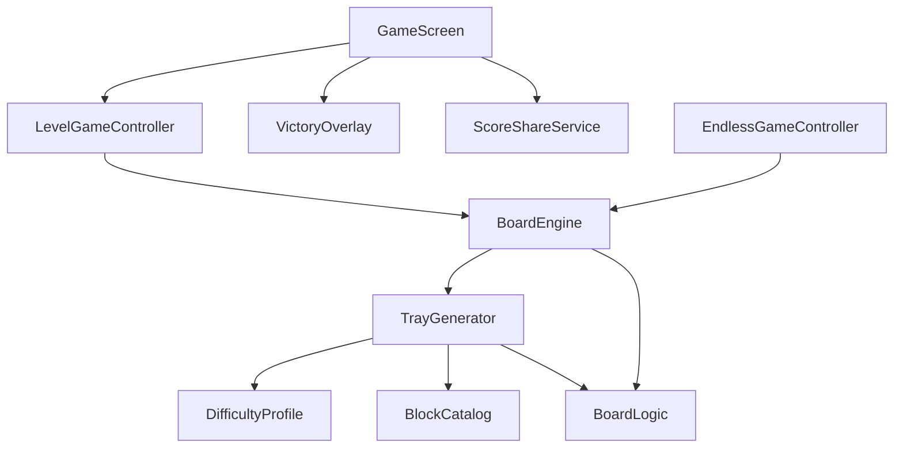

# Component Catalogue

Nguồn: requirements.md, stories.md, architecture.md và component-inventory.md (code KB), team-practices.md. Các component đã có trong code được đánh dấu "existing"; "new" là phần mới.

```yaml
components:
  - name: TrayGenerator
    summary: "(new) Sinh khay 3 khối theo bảng hiện tại và mức độ khó, bảo đảm có nước đi."
    behaviour: >
      Với mỗi khối: chọn khối "cứu" (xóa ít nhất một dòng) với xác suất rescueRate nếu có;
      nếu không thì chọn hình nhỏ/vừa/lớn theo DifficultyProfile, tăng hình nhỏ khi bảng đầy trên 60%.
      Sau khi đủ 3 khối, nếu không khối nào đặt vừa thì thay một khối ngẫu nhiên bằng một khối ngẫu nhiên đặt vừa (nhỏ nhất 1x1).
      Nhận Random tiêm vào để test theo seed. Giữ tỉ lệ băng 5% và bom 5%.
    responsibilities:
      - Chọn khối cứu và khối theo tỉ lệ
      - Bảo đảm khay có ít nhất một khối đặt vừa khi bảng còn ô trống
    depends_on:
      - component: DifficultyProfile
        interaction: lấy tỉ lệ nhỏ/vừa/lớn và rescueRate theo level
        style: sync
      - component: BlockCatalog
        interaction: lấy danh sách hình và màu
        style: sync
      - component: BoardLogic
        interaction: kiểm tra đặt vừa và xóa dòng
        style: sync
    dependents:
      - component: BoardEngine
        interaction: yêu cầu khay mới
    entities: []
  - name: DifficultyProfile
    summary: "(new) Đường cong độ khó thuần: level và độ đầy bảng thành tỉ lệ khối."
    behaviour: >
      Hàm thuần của (level 1..36, độ đầy bảng). Level 1: rescueRate 30%, level 36: 10%, tuyến tính.
      Tỉ lệ khối lớn tăng theo level. Khi bảng đầy trên 60% (hơn 38 trong 64 ô) tăng khối nhỏ, giảm khối lớn.
      Mọi hằng số nằm một chỗ. Endless dùng level 18.
    responsibilities:
      - Chứa các hằng số độ khó
      - Tính TrayRates cho một (level, độ đầy)
    depends_on: []
    dependents:
      - component: TrayGenerator
        interaction: đọc tỉ lệ
    entities:
      - name: TrayRates
        identifier: level
        attributes: [smallRate, mediumRate, largeRate, rescueRate]
  - name: BlockCatalog
    summary: "(existing, hiện là các bảng hình và màu trong block_generator.dart) Danh mục hình khối và bảng màu."
    behaviour: >
      Giữ nguyên 8 hình nhỏ, 10 hình vừa, 7 hình lớn và 7 màu; không còn tự sinh khay.
    responsibilities:
      - Cung cấp hình theo nhóm kích thước và màu
    depends_on: []
    dependents:
      - component: TrayGenerator
        interaction: lấy hình và màu
    entities:
      - name: BlockModel
        identifier: shape
        attributes: [shape, color, isIce, iceHealth, isBomb, isClearing]
  - name: BoardLogic
    summary: "(existing) Quy tắc bảng 8x8: đặt, xóa dòng, kiểm tra đặt vừa."
    behaviour: >
      Giữ nguyên; TrayGenerator dùng canPlaceBlock và dò dòng đầy khi thử khối cứu.
    responsibilities:
      - Đặt khối, xóa dòng, kiểm tra nước đi
    depends_on: []
    dependents:
      - component: TrayGenerator
        interaction: kiểm tra đặt vừa và khả năng xóa dòng
      - component: BoardEngine
        interaction: đặt khối và xóa dòng
    entities:
      - name: CellModel
        identifier: position
        attributes: [filled, color, isIce, isBomb, clearing, preview]
  - name: BoardEngine
    summary: "(existing, sửa) Bảng, khay, điểm, combo của một ván."
    behaviour: >
      Nhận mức độ khó từ controller khi reset và refill, gọi TrayGenerator thay cho BlockSource không tham số.
      Vẫn không biết mốc điểm hay tiến trình.
    responsibilities:
      - Giữ bảng, khay, điểm, combo
      - Làm mới khay qua TrayGenerator
    depends_on:
      - component: TrayGenerator
        interaction: sinh khay
        style: sync
      - component: BoardLogic
        interaction: đặt khối, xóa dòng
        style: sync
    dependents:
      - component: LevelGameController
        interaction: chạy lượt chơi
      - component: EndlessGameController
        interaction: chạy lượt chơi
    entities: []
  - name: LevelGameController
    summary: "(existing, sửa nhỏ) Vòng đời một level; truyền levelIndex làm mức độ khó và quyết định Victory/Game Over."
    behaviour: >
      Truyền levelIndex cho BoardEngine; thua chỉ khi cả khối 1x1 cũng không đặt vừa.
    responsibilities:
      - Điều phối level, thắng, thua
    depends_on:
      - component: BoardEngine
        interaction: chạy lượt
        style: sync
    dependents:
      - component: GameScreen
        interaction: hiển thị trạng thái
    entities: []
  - name: EndlessGameController
    summary: "(existing, sửa nhỏ) Vòng đời ván Endless; dùng mức độ khó cố định 18."
    behaviour: >
      Truyền mức độ khó 18 cho BoardEngine.
    responsibilities:
      - Điều phối ván Endless
    depends_on:
      - component: BoardEngine
        interaction: chạy lượt
        style: sync
    dependents: []
    entities: []
  - name: ScoreShareService
    summary: "(existing, sửa) Chụp màn hình và mở khung chia sẻ."
    behaviour: >
      Thêm shareVictory({screenshot, levelName, score}); giữ shareScore cho Game Over. Mọi chuỗi dùng Block Jewel.
      Lỗi chụp hoặc chia sẻ chỉ ghi log, không ném ra ngoài.
    responsibilities:
      - Chụp và chia sẻ ảnh
    depends_on: []
    dependents:
      - component: GameScreen
        interaction: gọi chia sẻ
    entities: []
  - name: VictoryOverlay
    summary: "(existing, sửa) Màn Victory có nút SHARE ở cả 3 biến thể."
    behaviour: >
      Thêm callback onShare và nút SHARE không chặn CONTINUE/BACK TO MENU; level 36 hiện SHARE cạnh BACK TO MENU.
    responsibilities:
      - Hiển thị Victory và nút SHARE
    depends_on: []
    dependents:
      - component: GameScreen
        interaction: hiển thị overlay
    entities: []
  - name: GameScreen
    summary: "(existing, sửa nhỏ) Màn chơi; nối nút SHARE ở Victory với ScoreShareService."
    behaviour: >
      Truyền ScreenshotController và tên level cho shareVictory; chỉ render, logic ở controller.
    responsibilities:
      - Render màn chơi và nối callback
    depends_on:
      - component: LevelGameController
        interaction: đọc trạng thái
        style: sync
      - component: VictoryOverlay
        interaction: hiển thị Victory
        style: sync
      - component: ScoreShareService
        interaction: chia sẻ ảnh
        style: async
    dependents: []
    entities: []
  - name: AppShell
    summary: "(existing, sửa) Vỏ ứng dụng: tên game, splash trong code và tài nguyên khởi động native."
    behaviour: >
      Đổi tên thành Block Jewel; một màn splash thấy được (SplashScreen); nền khởi động native Android và iOS
      là #0F0C29 không ảnh; gỡ flutter_native_splash khỏi pubspec.
    responsibilities:
      - Tên hiển thị, splash, cấu hình khởi động
    depends_on: []
    dependents: []
    entities: []
```

## Component Diagram

Văn bản: GameScreen → LevelGameController, VictoryOverlay, ScoreShareService; cả hai controller → BoardEngine → TrayGenerator, BoardLogic; TrayGenerator → DifficultyProfile, BlockCatalog, BoardLogic. AppShell đứng riêng.

## Component Summary
| Component | Purpose | Depends On | Dependents | Entities Owned |
|---|---|---|---|---|
| TrayGenerator | Sinh khay có nước đi | DifficultyProfile, BlockCatalog, BoardLogic | BoardEngine | - |
| DifficultyProfile | Đường cong độ khó | - | TrayGenerator | TrayRates |
| BlockCatalog | Hình và màu | - | TrayGenerator | BlockModel |
| BoardLogic | Quy tắc bảng | - | TrayGenerator, BoardEngine | CellModel |
| BoardEngine | Bảng, khay, điểm | TrayGenerator, BoardLogic | LevelGameController, EndlessGameController | - |
| LevelGameController | Vòng đời level | BoardEngine | GameScreen | - |
| EndlessGameController | Vòng đời Endless | BoardEngine | - | - |
| ScoreShareService | Chia sẻ ảnh | - | GameScreen | - |
| VictoryOverlay | Màn Victory | - | GameScreen | - |
| GameScreen | Màn chơi | LevelGameController, VictoryOverlay, ScoreShareService | - | - |
| AppShell | Tên, splash, khởi động | - | - | - |

## Entity Ownership
| Entity | Owning Component | Identifier | Attributes | References |
|---|---|---|---|---|
| TrayRates | DifficultyProfile | level | smallRate, mediumRate, largeRate, rescueRate | - |
| BlockModel | BlockCatalog | shape | shape, color, isIce, iceHealth, isBomb, isClearing | - |
| CellModel | BoardLogic | position | filled, color, isIce, isBomb, clearing, preview | - |

## External Dependencies
| Component | Dependency | Kind | Purpose |
|---|---|---|---|
| ScoreShareService | share_plus, screenshot, path_provider | other | chia sẻ ảnh |
| AppShell | Android/iOS launch resources | other | nền khởi động |

## Rationale
| Component | Vì sao tách riêng |
|---|---|
| TrayGenerator | Thay đổi nhiều nhất, cần test theo seed, tách khỏi danh mục hình |
| DifficultyProfile | Hằng số cân bằng thay đổi thường xuyên, hàm thuần dễ test |
| BlockCatalog | Dữ liệu hình ít đổi |
| BoardEngine | Vòng đời bảng, đã tồn tại |
| ScoreShareService | Phụ thuộc plugin nền tảng, cần giả khi test |
| VictoryOverlay | Chỉ render, thêm nút |
| AppShell | Tên và khởi động đổi cùng lúc, không có logic |

**Alternatives Rejected:** mở rộng hàm tĩnh `BlockGenerator` (khó tiêm Random, khó test); đặt đường cong độ khó trong TrayGenerator (khó chỉnh riêng); engine giữ thuộc tính level (trạng thái ẩn khó kiểm).
