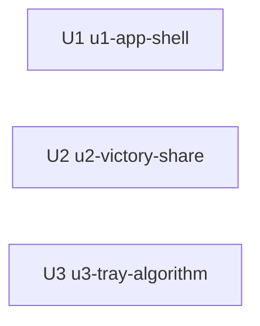

# Unit Dependencies

## DAG
Không có cạnh nào: ba unit độc lập.



## Điểm tích hợp
- U2 và U3 cùng chạm `GameScreen`/controller nhưng ở các phần khác nhau (callback chia sẻ so với truyền mức độ khó); xung đột sửa file được giải quyết khi ghép.
- U1 chạm tên hiển thị; test splash cũ phải đổi theo.

## Cơ hội làm song song
Cả ba unit có thể làm theo bất kỳ thứ tự nào. Unit đầu tiên chạy xuyên suốt là U1 (bản mỏng theo quy ước team); thứ tự còn lại do Delivery Planning quyết.

```yaml
units:
  - name: u1-app-shell
    kind: packaging
    depends_on: []
  - name: u2-victory-share
    kind: ui
    depends_on: []
  - name: u3-tray-algorithm
    kind: library
    depends_on: []
```
