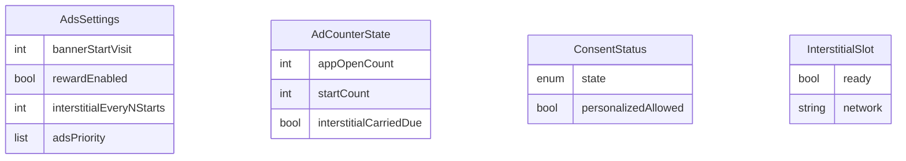

# Đặc tả chức năng: u1-ads-core

Nguồn: `entities.md`, `rules.md`, `stories.md` (US1.1, US1.2, US1.3, US2.1), `contract-summary.md` và `functional-design-questions.md`. Tài liệu không phụ thuộc ngôn ngữ lập trình và là nguồn đúng cho các luồng và trạng thái.

## Luồng 1: Khởi động ứng dụng (US1.1)

1. Ứng dụng khởi động, Splash chạy `AppBootstrap` với hạn chót 3,5 giây. (BR1.4)
2. `AppBootstrap` nạp Firebase và tải Remote Config. Nếu không tải được, `AdsConfig` dùng mặc định. (BR1.2)
3. `AdsConfig` kiểm tra từng tham số: số nguyên dương hợp lệ thì dùng, ngược lại dùng mặc định và ghi một dòng cảnh báo. (BR1.1, BR1.3)
4. `AdCounters` tăng `appOpenCount` cho lần khởi động nguội. (BR5.1)
5. Việc khởi tạo quảng cáo và đồng ý chạy nền, không chờ. Splash chuyển sang Home khi phần còn lại xong hoặc hết hạn chót. (BR1.4)

## Luồng 2: Lần vào Home đầu tiên và đồng ý (US1.3)

1. Sau khi vào Home lần đầu, `ConsentService` kiểm tra khu vực và nền tảng. (BR3.4)
2. Nếu cần, hiện hộp thoại đồng ý hoặc xin phép theo dõi. Cho đến khi xong, chưa có quảng cáo nào được yêu cầu. (BR3.1)
3. Kết quả: đồng ý thì `personalizedAllowed` là true, từ chối thì quảng cáo không cá nhân hóa, không áp dụng thì như đồng ý. (BR3.2, BR3.3)
4. Khi đồng ý đã xử lý, `AdMediator` bắt đầu tải trước interstitial. (BR4.6)

## Luồng 3: Người chơi bấm Start (US2.1, US1.2)

1. Người chơi bấm PLAY ở Home hoặc PLAY AGAIN ở Game Over, ở Journey hoặc Endless. (BR4.3)
2. `AdCounters` tăng `startCount` và lưu. (BR4.1)
3. `AdMediator` kiểm tra: `startCount` chia hết cho `interstitialEveryNStarts`, hoặc `interstitialCarriedDue` là true? (BR4.2)
4. Nếu không: vào màn chơi ngay.
5. Nếu có và đồng ý đã xử lý: kiểm tra `InterstitialSlot.ready`.
   - Sẵn sàng: hiện quảng cáo, đặt `interstitialCarriedDue` về false, rồi vào màn chơi khi quảng cáo đóng. Sau đó bắt đầu tải trước interstitial kế tiếp. (BR4.2, BR4.6)
   - Chưa sẵn sàng: bỏ qua, vào màn chơi ngay không chờ, đặt `interstitialCarriedDue` là true để bù ở lần bấm kế tiếp. (BR4.4)
6. Không có khoảng cách thời gian tối thiểu giữa hai lần hiện. (BR4.5)

## Luồng 4: Chọn mạng khi tải quảng cáo (US1.2)

1. `AdMediator` lấy `adsPriority` đã chuẩn hóa: bỏ tên lạ, thiếu thì dùng mặc định. (BR2.2, BR2.3)
2. Thử mạng đứng đầu. Nếu không phản hồi trong 5 giây hoặc không có quảng cáo thì thử mạng kế. (BR2.1, BR2.5)
3. Nếu mọi mạng đều không có quảng cáo: không hiện quảng cáo, `InterstitialSlot.ready` giữ là false, game chạy tiếp bình thường. (BR2.4)
4. Dùng ID thử trong bản debug và ID thật trong bản phát hành. (BR5.2)

## Luồng 5: Ứng dụng trở lại trước màn hình từ nền

1. Hệ điều hành báo ứng dụng trở lại trước màn hình.
2. Nếu lần trở lại do quảng cáo toàn màn hình vừa đóng, hộp thoại đồng ý hoặc xin phép theo dõi, hoặc bảng chia sẻ đóng: không đếm. (BR5.3)
3. Ngược lại: `appOpenCount` tăng một và lưu. (BR5.1)

## Máy trạng thái: ConsentStatus.state

| Trạng thái hiện tại | Sự kiện | Điều kiện | Trạng thái kế |
|---------------------|---------|-----------|---------------|
| not_processed | Vào Home lần đầu | Khu vực hoặc nền tảng cần đồng ý | required |
| not_processed | Vào Home lần đầu | Không cần đồng ý | not_applicable |
| required | Người dùng đồng ý | | granted |
| required | Người dùng từ chối | | denied |

granted, denied và not_applicable là trạng thái cuối trong một phiên chạy. Trạng thái được đọc lại ở mỗi lần khởi động.

## Máy trạng thái: InterstitialSlot

| Trạng thái hiện tại | Sự kiện | Trạng thái kế |
|---------------------|---------|---------------|
| chưa sẵn sàng | Tải trước thành công | sẵn sàng |
| chưa sẵn sàng | Tải trước thất bại hoặc hết 5 giây ở mọi mạng | chưa sẵn sàng (thử lại ở lần tải trước kế) |
| sẵn sàng | Hiện quảng cáo | chưa sẵn sàng, rồi bắt đầu tải trước kế |

## Sơ đồ quan hệ thực thể (suy ra từ entities.md)

Các thực thể không có quan hệ khóa với nhau, mỗi thực thể thuộc đúng một thành phần. Dạng văn bản nếu không hiển thị được sơ đồ: bốn thực thể độc lập là `AdsSettings`, `AdCounterState`, `ConsentStatus` và `InterstitialSlot`.

## Tóm tắt quy tắc (suy ra từ rules.md)

Có 22 quy tắc từ BR1.1 đến BR5.3. Nhóm cấu hình (BR1.x), thứ tự mạng (BR2.x), đồng ý (BR3.x), interstitial (BR4.x) và bộ đếm cùng ID (BR5.x).

## Assumptions & Open Questions

None.
