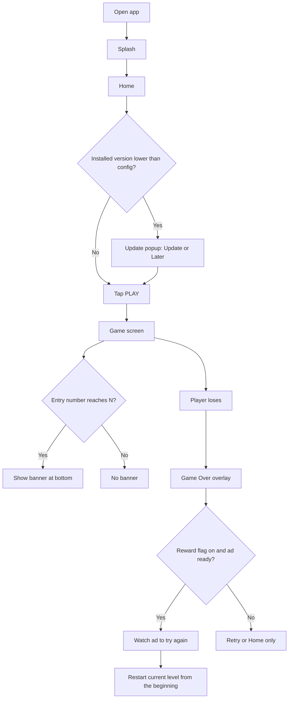

# Luồng người dùng: Quảng cáo và Remote Config

Nguồn: `wireframes.md`, `scope-document.md` và `rough-mockups-questions.md`.

## Luồng chính

Nguồn: Q1, Q2, Q3, Q4, Q5, Q6. Dạng văn bản nếu không hiển thị được sơ đồ: Splash, rồi Home, popup cập nhật nếu bản cài đặt thấp hơn bản cấu hình, sau đó bấm PLAY vào màn chơi, banner chỉ hiện từ lần vào thứ N, khi thua hiện lớp phủ Game Over, nút xem quảng cáo chỉ hiện khi cờ bật và quảng cáo sẵn sàng, xem xong thì chơi lại level hiện tại từ đầu.

## Luồng interstitial

Quảng cáo interstitial hiện sau mỗi N lần bấm Start, N cấu hình trên Firebase. Điểm hiện chính xác (trước hay sau màn chơi) chưa được xác nhận và để bước yêu cầu quyết định. (`scope-document.md` hạng mục 3)

## Điểm cần làm rõ ở bước sau

- Sau khi xem reward ads, người chơi bắt đầu lại level từ đầu theo Q3. Ý định ban đầu viết "tiếp tục ở level hiện tại". Bước yêu cầu cần xác nhận hai cách hiểu này khớp nhau. (Q3, `intent-statement.md`)

## Assumptions & Open Questions

None.
