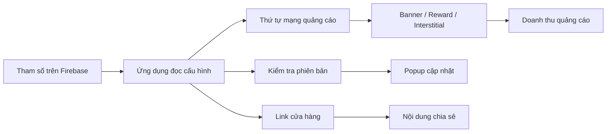

# Tài liệu phạm vi: Quảng cáo và Remote Config

Nguồn: `intent-statement.md`, `feasibility-assessment.md`, `constraint-register.md` và `scope-definition-questions.md`.

## Trong phạm vi

Tất cả đều là Must Have, không có hạng mục nào hoãn được. (Q1, Q2 của scope-definition)

| Hạng mục | Nội dung | Nguồn |
|----------|----------|-------|
| 1 | Banner ở màn chơi, chỉ hiện từ lần vào thứ N (mặc định lần 3, N cấu hình được) | `intent-statement.md`, Q1 |
| 2 | Nút xem reward ads để tiếp tục ở level hiện tại thay vì quay về Rough Stone khi thua, có cờ bật/tắt trên Firebase | `intent-statement.md`, Q1 |
| 3 | Interstitial ads sau mỗi N lần bấm Start, N cấu hình trên Firebase | `intent-statement.md`, Q1 |
| 4 | `ads_priority` quyết định thứ tự mediation cho banner, reward và interstitial | `intent-statement.md`, Q1 |
| 5 | Cấu hình `android_version`, `android_url`, `ios_version`, `ios_url` để kiểm tra phiên bản và hiện popup cập nhật | `intent-statement.md`, Q1 |
| 6 | Dùng `android_url` và `ios_url` trong nội dung chia sẻ | `intent-statement.md`, Q1 |
| Nền tảng | Xử lý đồng ý của người dùng (GDPR/ATT hoặc tương đương) như một phần bắt buộc của việc hiển thị quảng cáo | Q5, `constraint-register.md` C7 |

## Ngoài phạm vi

- Gói trả tiền để tắt quảng cáo. (Q6)

Các việc khác ngoài danh sách trên (quảng cáo native hoặc app open, báo cáo doanh thu trong ứng dụng, đa ngôn ngữ) chưa được xác nhận là loại trừ nên không được coi là ngoài phạm vi, cũng không được coi là trong phạm vi. (Q6)

## Thứ tự ưu tiên và phụ thuộc

- Ưu tiên theo giá trị: làm hạng mục mang lại doanh thu hoặc lợi ích lớn nhất trước. (Q3)
- Làm phần nền dùng chung trước (đọc cấu hình, thứ tự mạng, tải quảng cáo), sau đó thêm từng loại quảng cáo. (Q4)
- Hạng mục 1, 2, 3 cùng phụ thuộc hạng mục 4 và việc đọc cấu hình từ Remote Config. (Q4, `feasibility-assessment.md`)
- Cả 6 hạng mục đều bắt buộc, nên thứ tự chỉ quyết định làm gì trước, không quyết định giữ lại gì. (Q1, Q3)

## Ràng buộc áp dụng

- Không có mốc thời gian cố định và không có hạng mục gắn thời hạn cứng. (Q7, `constraint-register.md` C4)
- Thời gian duyệt trên cửa hàng ứng dụng có thể làm chậm phát hành. (`constraint-register.md` C5)
- Mọi chuỗi hiển thị trên UI chỉ dùng tiếng Anh. (`constraint-register.md` C9)

## Bản đồ luồng giá trị

Bản đồ này tóm tắt cùng các quan hệ phụ thuộc đã nêu ở trên. Nếu không hiển thị được sơ đồ, dùng dạng văn bản: Firebase, rồi ứng dụng đọc cấu hình, rồi chia thành ba nhánh gồm thứ tự mạng và quảng cáo dẫn đến doanh thu, kiểm tra phiên bản dẫn đến popup cập nhật, và link cửa hàng dẫn đến nội dung chia sẻ. (Q4)

## Assumptions & Open Questions

None.
