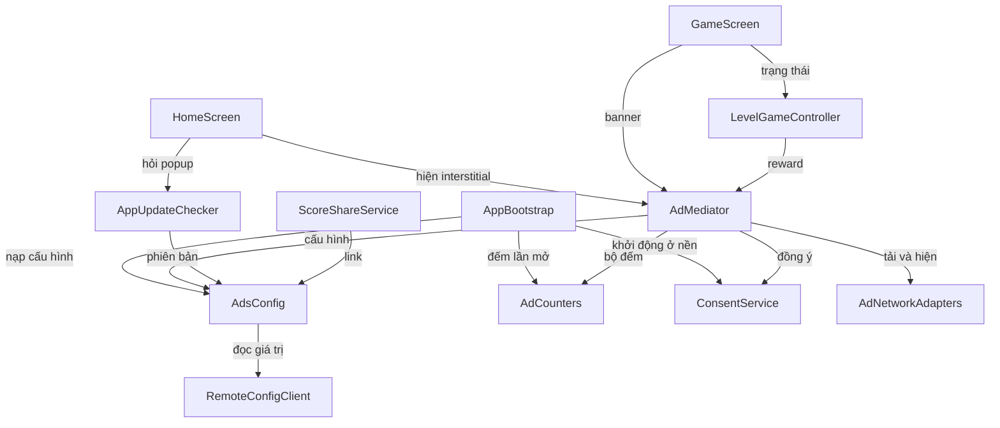

# Danh mục thành phần: Quảng cáo và Remote Config

Nguồn: `requirements.md`, `stories.md`, `architecture.md`, `component-inventory.md`, `team-practices.md` và `domain-design-questions.md`. Danh mục gồm các thành phần mới và các thành phần hiện có bị thay đổi. Tên thành phần hiện có giữ nguyên như trong `component-inventory.md`. Chưa quyết định cấu trúc triển khai hay thư viện cụ thể.

```yaml
components:
  - name: AdsConfig
    summary: Đọc các tham số quảng cáo và phiên bản từ Remote Config, trả mặc định khi thiếu hoặc sai.
    behaviour: >
      Cung cấp một đối tượng cấu hình chỉ đọc gồm banner_start_visit (mặc định 3), reward_enabled (mặc định true),
      interstitial_every_n_starts (mặc định 3), ads_priority (mặc định admob,unity,applovin), android_version,
      android_url, ios_version, ios_url (mặc định rỗng). Giá trị số không phải số nguyên dương coi như thiếu và dùng mặc định.
      Không bao giờ ném lỗi ra ngoài khi không tải được cấu hình.
    responsibilities:
      - Phân tích và kiểm tra giá trị cấu hình
      - Áp dụng giá trị mặc định
    depends_on:
      - component: RemoteConfigClient
        interaction: đọc giá trị thô theo kiểu
        style: sync
    dependents:
      - component: AdMediator
        interaction: lấy ads_priority và các ngưỡng đếm
      - component: AppUpdateChecker
        interaction: lấy phiên bản và đường dẫn cửa hàng
      - component: ScoreShareService
        interaction: lấy đường dẫn cửa hàng để thêm vào nội dung chia sẻ
      - component: AppBootstrap
        interaction: nạp cấu hình lúc khởi động
    external_dependencies: []
    entities:
      - name: AdsSettings
        identifier: singleton
        attributes: [bannerStartVisit, rewardEnabled, interstitialEveryNStarts, adsPriority, androidVersion, androidUrl, iosVersion, iosUrl]

  - name: RemoteConfigClient
    summary: Cổng tới Firebase Remote Config, mở rộng với các hàm đọc chung theo kiểu.
    behaviour: >
      Thành phần hiện có. Ngoài readLevelConfig, bổ sung đọc chuỗi, số nguyên và bật/tắt theo khóa, chỉ trả giá trị khi
      nguồn là remote. Giữ cài đặt tải hiện có (fetchTimeout 2 giây, minimumFetchInterval 12 giờ). Có bản giả để test.
    responsibilities:
      - Tải và kích hoạt cấu hình từ xa
      - Đọc giá trị theo khóa và kiểu
    depends_on: []
    dependents:
      - component: AdsConfig
        interaction: đọc tham số quảng cáo và phiên bản
    external_dependencies:
      - name: Firebase Remote Config
        kind: third-party-api
        purpose: lưu và phân phối cấu hình từ xa
    entities: []

  - name: AdNetworkAdapters
    summary: Một adapter cho mỗi mạng quảng cáo, cùng một interface, gồm AdMob, Unity và AppLovin.
    behaviour: >
      Mỗi adapter có thể tải và hiện banner, reward và interstitial của mạng của nó, và báo kết quả: có quảng cáo, không
      có quảng cáo, đã xem đủ, đóng sớm hoặc lỗi. Mọi lỗi SDK được bắt và trả về như kết quả, không ném ra ngoài.
    responsibilities:
      - Tải trước quảng cáo
      - Hiện quảng cáo và báo kết quả
    depends_on: []
    dependents:
      - component: AdMediator
        interaction: gọi mạng theo thứ tự ưu tiên
    external_dependencies:
      - name: SDK AdMob, Unity Ads, AppLovin
        kind: third-party-api
        purpose: cung cấp quảng cáo
    entities: []

  - name: ConsentService
    summary: Xử lý sự đồng ý của người dùng (EU/EEA, iOS) trước khi hiện quảng cáo.
    behaviour: >
      Báo trạng thái đồng ý: chưa xử lý, cần hỏi, đã đồng ý, từ chối hoặc không áp dụng. Khi từ chối thì quảng cáo ở dạng
      không cá nhân hóa. Chạy nền, không chặn màn Splash.
    responsibilities:
      - Hỏi và ghi nhận đồng ý theo khu vực và nền tảng
      - Cho biết quảng cáo có được cá nhân hóa hay không
    depends_on: []
    dependents:
      - component: AdMediator
        interaction: chỉ yêu cầu quảng cáo sau khi đồng ý đã được xử lý
      - component: AppBootstrap
        interaction: khởi động việc xử lý đồng ý ở nền
    external_dependencies:
      - name: SDK đồng ý của nền tảng
        kind: third-party-api
        purpose: hộp thoại đồng ý và trạng thái đồng ý
    entities:
      - name: ConsentStatus
        identifier: singleton
        attributes: [state, personalizedAllowed]

  - name: AdCounters
    summary: Lưu bền số lần mở ứng dụng và số lần bấm Start.
    behaviour: >
      Tăng bộ đếm số lần mở ứng dụng (mỗi lần mở một lần) và số lần bấm Start (nút PLAY ở Home và PLAY AGAIN ở Game Over),
      và giữ giá trị khi thoát ứng dụng. Đọc và ghi qua một interface kho lưu có bản giả để test.
    responsibilities:
      - Đếm lần mở ứng dụng
      - Đếm lần bấm Start
      - Lưu bền
    depends_on: []
    dependents:
      - component: AdMediator
        interaction: so bộ đếm với ngưỡng để quyết định hiện banner và interstitial
      - component: AppBootstrap
        interaction: ghi nhận lần mở ứng dụng
    external_dependencies:
      - name: SharedPreferences
        kind: other
        purpose: lưu bộ đếm bền
    entities:
      - name: AdCounterState
        identifier: singleton
        attributes: [appOpenCount, startCount]

  - name: AdMediator
    summary: Quyết định có hiện quảng cáo hay không, và chọn mạng theo thứ tự ads_priority.
    behaviour: >
      Với mỗi loại quảng cáo (banner, reward, interstitial), kiểm tra đồng ý và bộ đếm, rồi thử các mạng theo ads_priority
      cho đến khi một mạng có quảng cáo. Bỏ qua tên mạng không nhận ra. Banner chỉ hiện từ lần mở thứ banner_start_visit.
      Interstitial hiện sau mỗi interstitial_every_n_starts lần bấm Start. Reward trả kết quả đã xem đủ, đóng sớm, hoặc
      không có quảng cáo (khi đó người chơi vẫn được thưởng theo quyết định thiết kế).
    responsibilities:
      - Điều kiện hiển thị từng loại quảng cáo
      - Thứ tự mạng và thử lần lượt
    depends_on:
      - component: AdsConfig
        interaction: đọc ads_priority, ngưỡng và cờ reward_enabled
        style: sync
      - component: AdNetworkAdapters
        interaction: tải và hiện quảng cáo của từng mạng
        style: async
      - component: ConsentService
        interaction: chỉ yêu cầu quảng cáo khi đồng ý đã xử lý
        style: sync
      - component: AdCounters
        interaction: đọc và tăng bộ đếm
        style: sync
    dependents:
      - component: LevelGameController
        interaction: xin quảng cáo reward ở ván thua
      - component: HomeScreen
        interaction: hiện interstitial sau khi bấm PLAY
      - component: GameScreen
        interaction: hiện banner dưới màn chơi
    external_dependencies: []
    entities: []

  - name: AppUpdateChecker
    summary: Quyết định có hiện popup cập nhật hay không.
    behaviour: >
      So tên phiên bản đang cài (bỏ phần số build) với phiên bản cấu hình của nền tảng, theo số cách nhau bằng dấu chấm.
      Chỉ báo cần cập nhật khi phiên bản cài đặt thấp hơn, phiên bản và đường dẫn hợp lệ, và chưa hiện trong lần mở ứng dụng này.
    responsibilities:
      - So sánh phiên bản
      - Cung cấp đường dẫn cửa hàng cho nút Update
    depends_on:
      - component: AdsConfig
        interaction: đọc phiên bản và đường dẫn của nền tảng
        style: sync
    dependents:
      - component: HomeScreen
        interaction: hỏi có cần hiện popup khi vào Home
    external_dependencies:
      - name: Thư viện đọc phiên bản đang cài
        kind: other
        purpose: lấy tên phiên bản lúc chạy
    entities: []

  - name: ScoreShareService
    summary: Chia sẻ điểm và chiến thắng, thêm đường dẫn cửa hàng vào cuối văn bản.
    behaviour: >
      Thành phần hiện có. Thêm đường dẫn cửa hàng của nền tảng (android_url hoặc ios_url) vào cuối nội dung chia sẻ khi
      đường dẫn hợp lệ, nếu không thì giữ nguyên nội dung hiện tại.
    responsibilities:
      - Tạo nội dung chia sẻ có link
    depends_on:
      - component: AdsConfig
        interaction: đọc đường dẫn cửa hàng
        style: sync
    dependents: []
    external_dependencies: []
    entities: []

  - name: LevelGameController
    summary: Điều khiển ván chơi theo level, thêm luồng reward ads và hoãn ghi nhận thua.
    behaviour: >
      Thành phần hiện có. Khi hết nước đi, không ghi nhận thua ngay mà chờ đến khi người chơi rời lớp phủ Game Over bằng
      PLAY AGAIN hoặc BACK TO MENU. Nếu người chơi nhận thưởng thì điểm về 0, bàn cờ sạch, khay mới, level không bị hạ và
      thua không được ghi nhận. Mỗi ván thua chỉ dùng reward một lần.
    responsibilities:
      - Trạng thái ván chơi và thưởng
      - Thời điểm ghi nhận thua
    depends_on:
      - component: AdMediator
        interaction: xin quảng cáo reward
        style: async
    dependents:
      - component: GameScreen
        interaction: hiển thị trạng thái và lớp phủ Game Over
    external_dependencies: []
    entities: []

  - name: AppBootstrap
    summary: Khởi tạo ứng dụng, thêm nạp cấu hình quảng cáo, đếm lần mở và khởi động đồng ý ở nền.
    behaviour: >
      Thành phần hiện có. Khởi tạo quảng cáo và đồng ý chạy nền, không chặn và không tính vào hạn chót 3,5 giây.
    responsibilities:
      - Khởi động các dịch vụ lúc mở ứng dụng
    depends_on:
      - component: AdsConfig
        interaction: nạp cấu hình quảng cáo
        style: sync
      - component: AdCounters
        interaction: ghi nhận lần mở ứng dụng
        style: sync
      - component: ConsentService
        interaction: khởi động xử lý đồng ý ở nền
        style: async
    dependents: []
    external_dependencies: []
    entities: []

  - name: HomeScreen
    summary: Màn Home, thêm popup cập nhật và interstitial sau khi bấm PLAY.
    behaviour: >
      Thành phần hiện có. Hiện popup cập nhật khi AppUpdateChecker báo cần, tối đa một lần mỗi lần mở ứng dụng.
      Sau khi bấm PLAY, nhờ AdMediator hiện interstitial nếu đủ N lần bấm, rồi mở màn chơi.
    responsibilities:
      - Hiển thị popup cập nhật
      - Điểm đếm lần bấm Start ở Home
    depends_on:
      - component: AdMediator
        interaction: hiện interstitial
        style: async
      - component: AppUpdateChecker
        interaction: hỏi có cần popup
        style: sync
    dependents: []
    external_dependencies: []
    entities: []

  - name: GameScreen
    summary: Màn chơi, thêm vùng banner dưới cùng và nút reward ở lớp phủ Game Over.
    behaviour: >
      Thành phần hiện có. Hiện banner do AdMediator cung cấp ở dưới cùng, và nút WATCH AD TO TRY AGAIN trong lớp phủ
      Game Over của chế độ Journey. Banner không che bàn cờ hay khay khối.
    responsibilities:
      - Hiển thị banner và nút reward
    depends_on:
      - component: AdMediator
        interaction: lấy banner
        style: async
      - component: LevelGameController
        interaction: trạng thái ván chơi
        style: sync
    dependents: []
    external_dependencies: []
    entities: []
```

## Component Diagram



Dạng văn bản nếu không hiển thị được sơ đồ: các màn hình (`HomeScreen`, `GameScreen`) và `LevelGameController` gọi `AdMediator`. `AdMediator` dùng `AdsConfig`, `AdNetworkAdapters`, `ConsentService` và `AdCounters`. `AdsConfig` đọc từ `RemoteConfigClient`. `AppUpdateChecker` và `ScoreShareService` dùng `AdsConfig`. `AppBootstrap` khởi động `AdsConfig`, `AdCounters` và `ConsentService`.

## Component Summary

| Component | Purpose | Depends On | Dependents | Entities Owned |
|-----------|---------|-----------|-----------|----------------|
| AdsConfig | Đọc tham số quảng cáo và phiên bản, trả mặc định | RemoteConfigClient | AdMediator, AppUpdateChecker, ScoreShareService, AppBootstrap | AdsSettings |
| RemoteConfigClient | Cổng tới Remote Config, thêm hàm đọc theo kiểu | | AdsConfig | |
| AdNetworkAdapters | Adapter cho AdMob, Unity, AppLovin | | AdMediator | |
| ConsentService | Xử lý đồng ý của người dùng | | AdMediator, AppBootstrap | ConsentStatus |
| AdCounters | Đếm lần mở ứng dụng và lần bấm Start | | AdMediator, AppBootstrap | AdCounterState |
| AdMediator | Điều kiện hiện quảng cáo và thứ tự mạng | AdsConfig, AdNetworkAdapters, ConsentService, AdCounters | LevelGameController, HomeScreen, GameScreen | |
| AppUpdateChecker | Quyết định popup cập nhật | AdsConfig | HomeScreen | |
| ScoreShareService | Nội dung chia sẻ có link | AdsConfig | | |
| LevelGameController | Luồng reward và hoãn ghi nhận thua | AdMediator | GameScreen | |
| AppBootstrap | Khởi tạo, đếm lần mở, đồng ý ở nền | AdsConfig, AdCounters, ConsentService | | |
| HomeScreen | Popup cập nhật và interstitial | AdMediator, AppUpdateChecker | | |
| GameScreen | Banner và nút reward | AdMediator, LevelGameController | | |

## Entity Ownership

| Entity | Owning Component | Identifier | Attributes | References |
|--------|------------------|-----------|-----------|-----------|
| AdsSettings | AdsConfig | singleton | bannerStartVisit, rewardEnabled, interstitialEveryNStarts, adsPriority, androidVersion, androidUrl, iosVersion, iosUrl | |
| ConsentStatus | ConsentService | singleton | state, personalizedAllowed | |
| AdCounterState | AdCounters | singleton | appOpenCount, startCount | |

## External Dependencies

| Component | Dependency | Kind | Purpose |
|-----------|-----------|------|---------|
| RemoteConfigClient | Firebase Remote Config | third-party-api | Cấu hình từ xa |
| AdNetworkAdapters | SDK AdMob, Unity Ads, AppLovin | third-party-api | Cung cấp quảng cáo |
| ConsentService | SDK đồng ý của nền tảng | third-party-api | Hộp thoại và trạng thái đồng ý |
| AdCounters | SharedPreferences | other | Lưu bộ đếm bền |
| AppUpdateChecker | Thư viện đọc phiên bản đang cài | other | Lấy tên phiên bản lúc chạy |

## Rationale

| Component | Vì sao là một khối riêng |
|-----------|--------------------------|
| AdsConfig | Một mối quan tâm riêng: cấu hình và mặc định. Đổi tên khóa hay mặc định chỉ ảnh hưởng một chỗ |
| AdNetworkAdapters | Mỗi mạng có SDK riêng, đổi theo nhịp của nhà cung cấp. Tách ra cho phép thêm hoặc bỏ mạng mà không đụng logic |
| ConsentService | Quy định đồng ý thay đổi theo luật và nền tảng, và phải áp cho mọi loại quảng cáo ở một chỗ |
| AdCounters | Vòng đời lưu bền riêng, không trộn vào `ProgressRepository` đã dày kiểm thử |
| AdMediator | Điều phối thứ tự mạng và điều kiện hiển thị, tách khỏi cách lấy quảng cáo của từng mạng |
| AppUpdateChecker | Không liên quan quảng cáo, thay đổi theo lý do khác (phát hành bản mới) |

### Phương án khác đã loại

- Gộp quảng cáo thành một `AdService` duy nhất bị loại vì khó kiểm thử từng phần và khó thêm mạng. (ADR-001)
- Thêm bộ đếm vào `ProgressRepository` bị loại vì tăng rủi ro hồi quy cho một lớp đã có nhiều kiểm thử. (ADR-002)
- Giữ ghi nhận thua ngay rồi hoàn tác khi nhận thưởng bị loại vì cần thêm một đường lưu và dễ lỗi nếu hoàn tác thất bại giữa chừng. (ADR-003)
- Tạo interface riêng cho tham số quảng cáo bị loại vì hai nơi cùng cấu hình Firebase Remote Config dễ lệch cài đặt. (ADR-004)
- Mỗi adapter tự xử lý đồng ý bị loại vì lặp ba lần và dễ không nhất quán. (ADR-005)
- Gộp kiểm tra phiên bản vào `AdsConfig` bị loại vì trộn hai mối quan tâm. (ADR-006)

## Assumptions & Open Questions

None.
