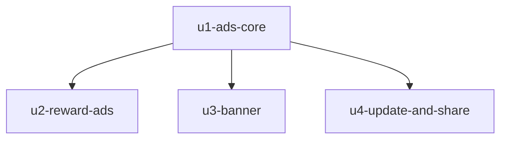

# Sơ đồ phụ thuộc giữa các unit

Nguồn: `unit-of-work.md`, `components.md` và `units-generation-questions.md`. Tài liệu này chỉ mô tả cái gì phụ thuộc cái gì. Thứ tự làm và đường găng thuộc bước lập kế hoạch giao hàng.

## Sơ đồ



Dạng văn bản: `u2-reward-ads`, `u3-banner` và `u4-update-and-share` đều phụ thuộc `u1-ads-core`. Ba unit này không phụ thuộc nhau.

## Điểm tích hợp

| Giữa | Điểm tích hợp |
|------|--------------|
| U1 và U2 | `AdMediator` trả kết quả reward (xem đủ, đóng sớm, không có quảng cáo) cho `LevelGameController` |
| U1 và U3 | `AdMediator` quyết định banner có hiện hay không, dựa trên `AdCounters` và `AdsConfig` |
| U1 và U4 | `AdsConfig` cung cấp phiên bản và đường dẫn cửa hàng cho `AppUpdateChecker` và `ScoreShareService` |

## Cơ hội phát triển song song

Sau khi U1 xong, U2, U3 và U4 độc lập với nhau nên có thể làm bất kỳ thứ tự nào, hoặc song song nếu có nhiều người. Đội chỉ có một developer nên sẽ làm lần lượt. Hai cặp thành phần chung (`HomeScreen` giữa U1 và U4, `GameScreen` giữa U2 và U3) là điểm cần chú ý khi gộp. (Q4 của units-generation)

## Bản đầu tiên chạy xuyên suốt

U1 là unit đầu tiên theo sơ đồ vì mọi unit khác phụ thuộc nó. U1 chạy được từ đầu đến cuối: đọc cấu hình từ Firebase, đếm lần bấm Start, chọn mạng và hiện interstitial ở màn Home, mà không cần U2, U3 hay U4. (Q2 của units-generation)

```yaml
units:
  - name: u1-ads-core
    kind: library
    depends_on: []
  - name: u2-reward-ads
    kind: ui
    depends_on: [u1-ads-core]
  - name: u3-banner
    kind: ui
    depends_on: [u1-ads-core]
  - name: u4-update-and-share
    kind: ui
    depends_on: [u1-ads-core]
```

## Assumptions & Open Questions

None.
